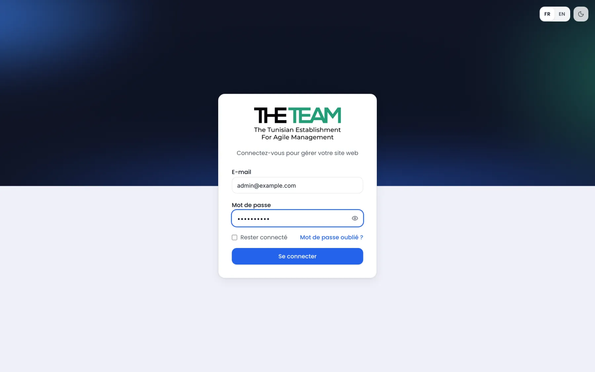
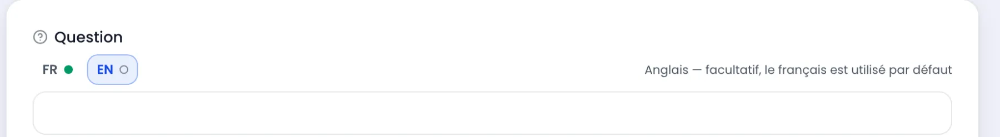
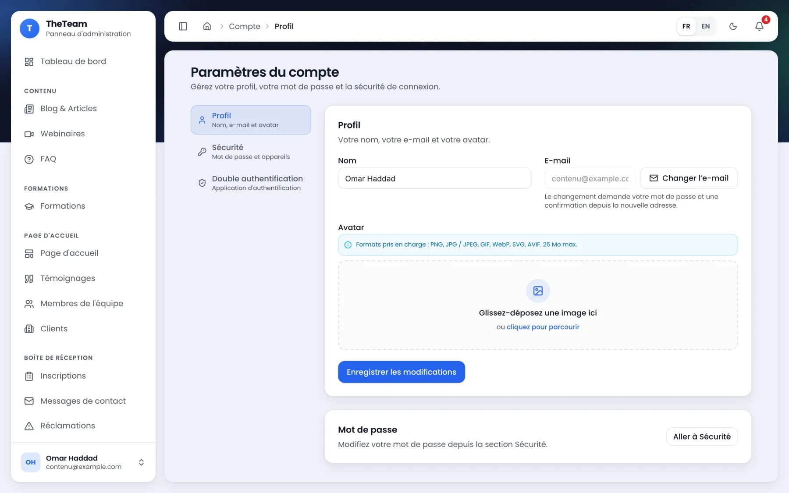

## Se connecter

**Première fois :** un administrateur vous envoie une **invitation par e-mail**. Cliquez sur le bouton de l’e-mail (le lien est valable **24 heures**), choisissez votre mot de passe (au moins 8 caractères), puis connectez-vous.

**Ensuite :** allez sur **admin.theteam.com.tn/admin**, saisissez votre e-mail et votre mot de passe, puis cliquez sur **Se connecter**.

<Frame caption="La page de connexion.">
  
</Frame>

- **Mot de passe oublié ?** Cliquez sur le lien sous le champ, saisissez votre e-mail et suivez le lien reçu.
- **Bloqué après plusieurs essais ?** Après 5 essais ratés en une minute, attendez une minute.
- **Se déconnecter :** cliquez sur votre nom en bas du menu, puis **Se déconnecter**.

## L’écran

- **À gauche, le menu** : vos parties du panneau.
- **En haut, la barre d’outils** : la langue (FR / EN), le mode sombre (lune) et la **cloche** des notifications.
- **Au centre, la page ouverte.** Le tableau de bord résume les demandes reçues ; une étiquette orange (« 2 nouveaux », « 3 ouvertes ») signale ce qui attend un traitement. Cliquez sur une case pour ouvrir la liste.

<Tip>
  **Ne ratez aucune demande** : la **cloche**, en haut à droite, vous prévient de chaque formulaire envoyé sur le site. Activez le son et les notifications de votre ordinateur en deux clics : voir [Notifications](/guide-utilisateur/gestionnaire/notifications).
</Tip>

## Les listes et les fiches

Toutes les listes fonctionnent pareil : **Rechercher**, cliquer sur un titre de colonne pour trier, filtres **Actifs / Archivés / Tous**, et des icônes au bout de chaque ligne :

| Icône | Action |
| :-- | :-- |
| Œil | Voir sans modifier |
| Crayon | Modifier |
| Boîte | Archiver (ranger sans supprimer) |

Dans une fiche : **Annuler** abandonne vos changements, **Enregistrer les modifications** les enregistre. Un message vert confirme ; un message rouge sous un champ dit quoi corriger. Les champs **LECTURE SEULE** sont affichés pour information.

## Le français et l’anglais

Les textes du site ont deux onglets, **FR** (obligatoire) et **EN** (facultatif). Si l’anglais est vide, la version anglaise du site affiche le français.

<Frame caption="Les onglets FR / EN d’un champ.">
  
</Frame>

## Mon profil

Menu **Compte → Mon profil**. Trois onglets :

- **Profil** : votre nom (affiché comme auteur de vos articles), votre photo, votre e-mail.
- **Sécurité** : changer votre mot de passe, voir et déconnecter les appareils connectés.
- **Double authentification** : un code à 6 chiffres sur votre téléphone à chaque connexion. **Recommandé.**

<Frame caption="Votre profil.">
  
</Frame>
