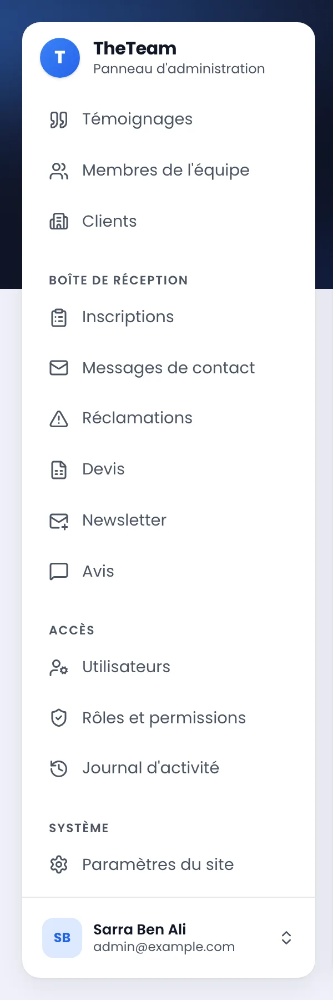
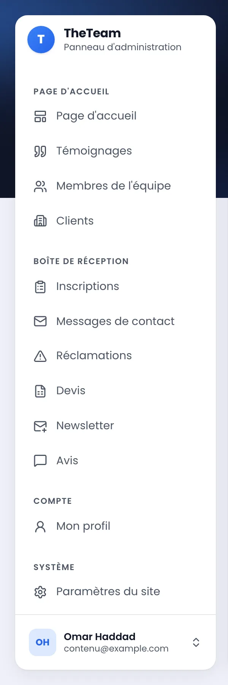

Ce guide vous explique, pas à pas, comment gérer le site **theteam.com.tn** depuis le **panneau d’administration**. Pas besoin de connaissances techniques : chaque écran est montré en image.

<Info>
  Le panneau d’administration se trouve à l’adresse **admin.theteam.com.tn/admin**. Il est en **français** par défaut.
</Info>

## Les deux rôles

Chaque compte a **un seul rôle**. C’est un administrateur qui le choisit.

<CardGroup cols={2}>
  <Card title="Administrateur" icon="user-shield">
    A **accès à tout** : contenu, boîte de réception, comptes du personnel, journal d’activité et paramètres du site. C’est le seul rôle qui peut **supprimer définitivement**.
  </Card>
  <Card title="Gestionnaire de contenu" icon="pen">
    **Gère le contenu** du site et **traite les demandes reçues** : il peut consulter, créer, modifier et archiver, mais **jamais supprimer**.
  </Card>
</CardGroup>

## Ce que chacun voit dans le menu

Le menu s’adapte au rôle. En bas, l’administrateur a la partie **Accès** (utilisateurs, rôles, journal d’activité) ; le gestionnaire de contenu a l’entrée **Mon profil** à la place.

<Columns cols={2}>
  <Frame caption="Fin du menu d’un administrateur.">
    
  </Frame>
  <Frame caption="Fin du menu d’un gestionnaire de contenu.">
    
  </Frame>
</Columns>

## Qui peut faire quoi ?

| Partie du panneau | Administrateur | Gestionnaire de contenu |
| :-- | :-- | :-- |
| Blog, articles, catégories, étiquettes | Tout | Créer et modifier |
| Webinaires, FAQ | Tout | Créer et modifier |
| Formations (et leurs catégories) | Tout | Créer et modifier |
| Page d’accueil | Tout | Seulement le **bandeau promo** et la **bannière** |
| Témoignages | Tout | Consulter, modifier et publier |
| Membres de l’équipe | Tout | Consulter seulement |
| Clients | Tout | Créer et modifier |
| Devis, réclamations | Tout | Consulter, traiter et archiver |
| Inscriptions | Tout | Consulter et modifier |
| Messages de contact | Tout | Consulter et archiver |
| Newsletter | Tout | Consulter, ajouter une adresse et exporter |
| Avis | Tout | Consulter seulement |
| Utilisateurs, rôles et permissions | Tout | Aucun accès |
| Journal d’activité | Consulter et sauvegarder | Aucun accès |
| Paramètres du site | Tout | Lancer les tests ; adresse de notification en lecture seule |

<Tip>
  Si un bouton décrit dans ce guide n’apparaît pas chez vous, c’est normal : votre rôle ne le permet pas. Le panneau n’affiche que ce que vous avez le droit de faire.
</Tip>

## Comment lire ce guide

<Steps>
  <Step title="Commencez par la prise en main">
    [Se connecter](/guide-utilisateur/connexion), puis [Découvrir le panneau](/guide-utilisateur/interface) : ces deux pages présentent les gestes utilisés partout (rechercher, enregistrer, archiver…).
  </Step>
  <Step title="Allez ensuite à la partie dont vous avez besoin">
    **Contenu du site** pour publier, **Boîte de réception** pour traiter les demandes des visiteurs.
  </Step>
  <Step title="Administrateurs : la partie Administration">
    Gestion des comptes du personnel, journal d’activité et paramètres du site.
  </Step>
</Steps>

<Note>
  Les captures d’écran ont été prises sur une copie de test remplie de **données fictives** (noms, entreprises, adresses e-mail en `example.com`). Elles ne montrent aucune donnée réelle.
</Note>
