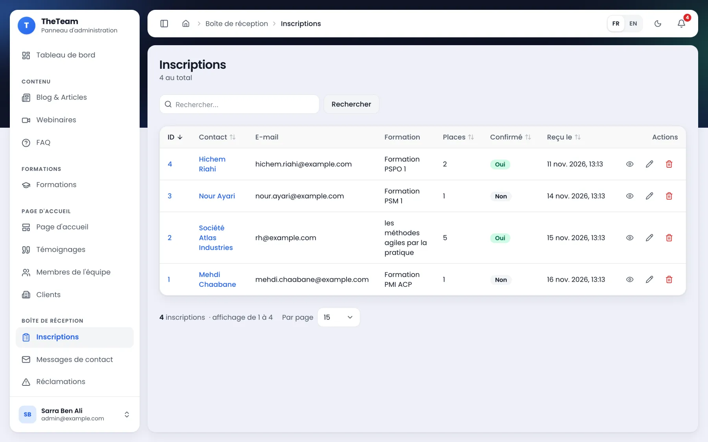
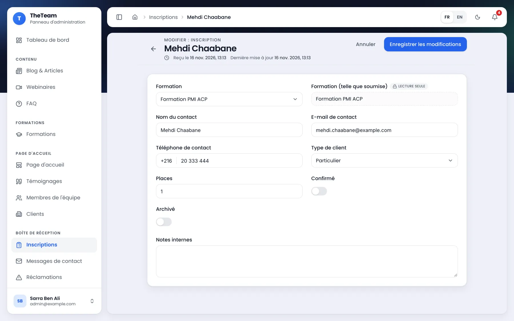

Menu **Boîte de réception → Inscriptions**. Quand un visiteur s’inscrit à une formation sur le site, l’inscription arrive ici et une notification vous prévient.

<Info>
  **Les deux rôles** peuvent consulter et modifier les inscriptions. Seul un **administrateur** peut supprimer.
</Info>

<Frame caption="La liste des inscriptions : contact, formation, nombre de places et confirmation.">
  
</Frame>

## Traiter une inscription

<Steps>
  <Step title="Ouvrez l’inscription">
    Cliquez sur le crayon de la ligne.
  </Step>
  <Step title="Vérifiez les informations">
    Formation, nom, e-mail, téléphone, type de client (particulier ou entreprise) et nombre de places. **Formation (telle que soumise)** garde le titre exact au moment de l’inscription, même si la formation est renommée plus tard.
  </Step>
  <Step title="Contactez la personne">
    Pour confirmer la session, le paiement, etc.
  </Step>
  <Step title="Confirmez">
    Activez **Confirmé**, ajoutez si besoin des **Notes internes**, puis cliquez sur **Enregistrer les modifications**.
  </Step>
</Steps>

<Frame caption="La fiche d’une inscription.">
  
</Frame>

<Tip>
  Sur le tableau de bord, l’étiquette **« en attente »** de la case Inscriptions compte les inscriptions pas encore confirmées.
</Tip>

L’interrupteur **Archivé** de la fiche permet de marquer une inscription comme terminée.
