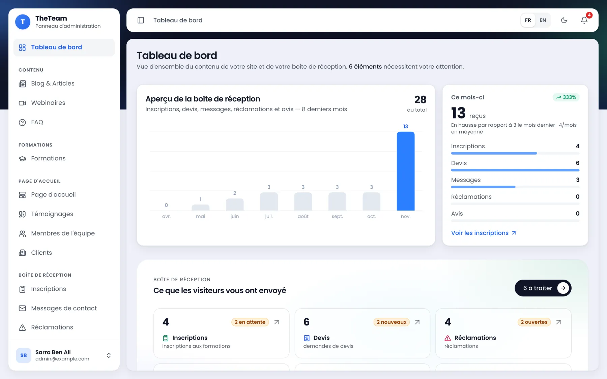
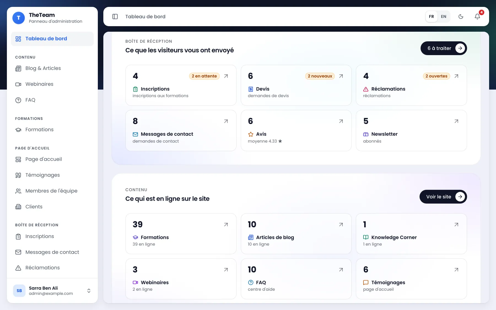
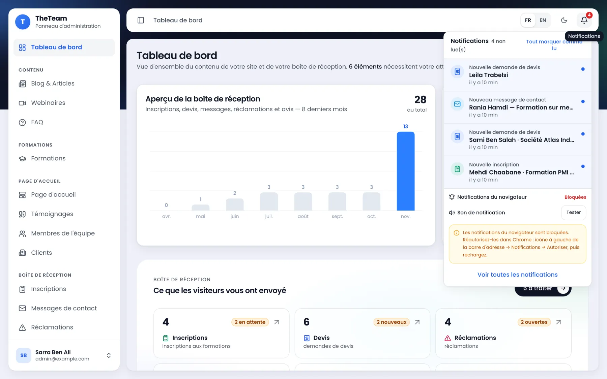
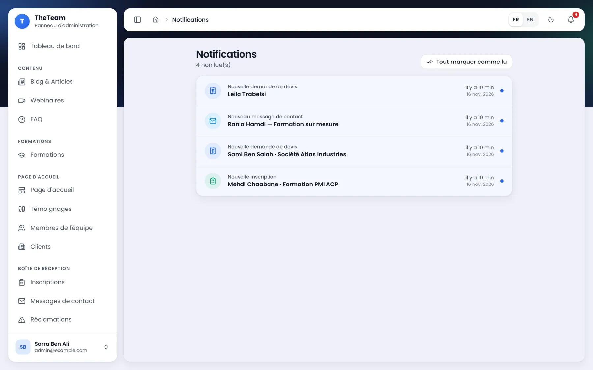
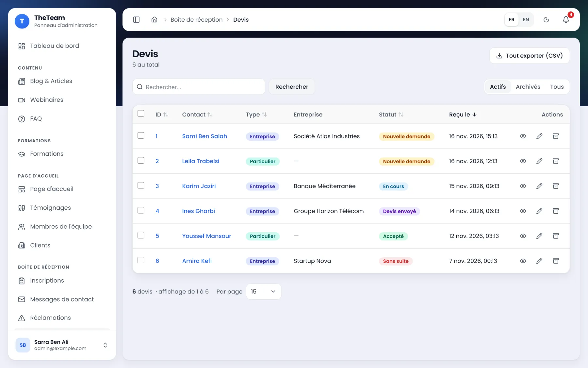
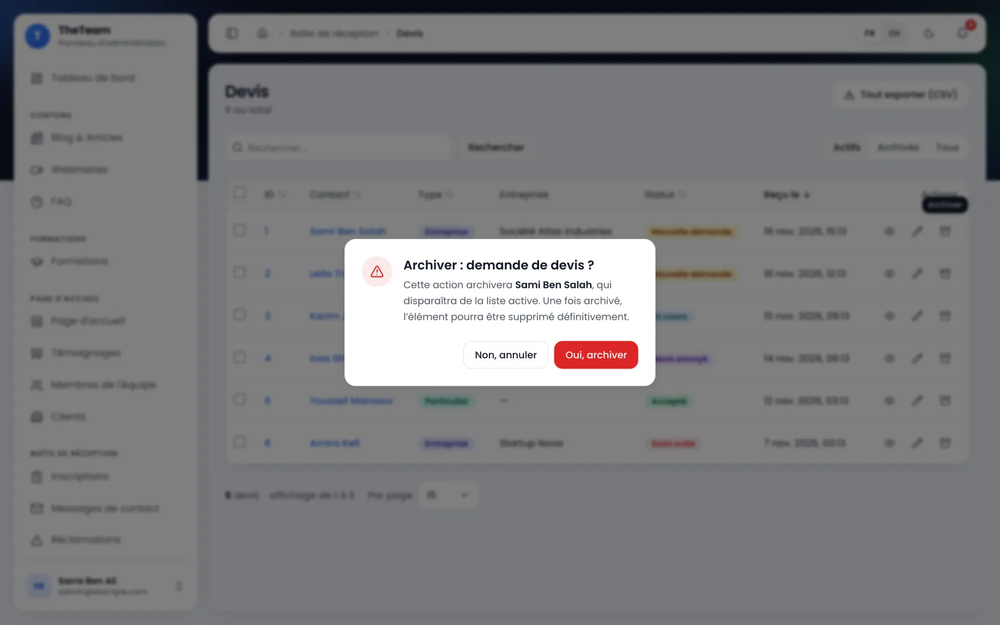
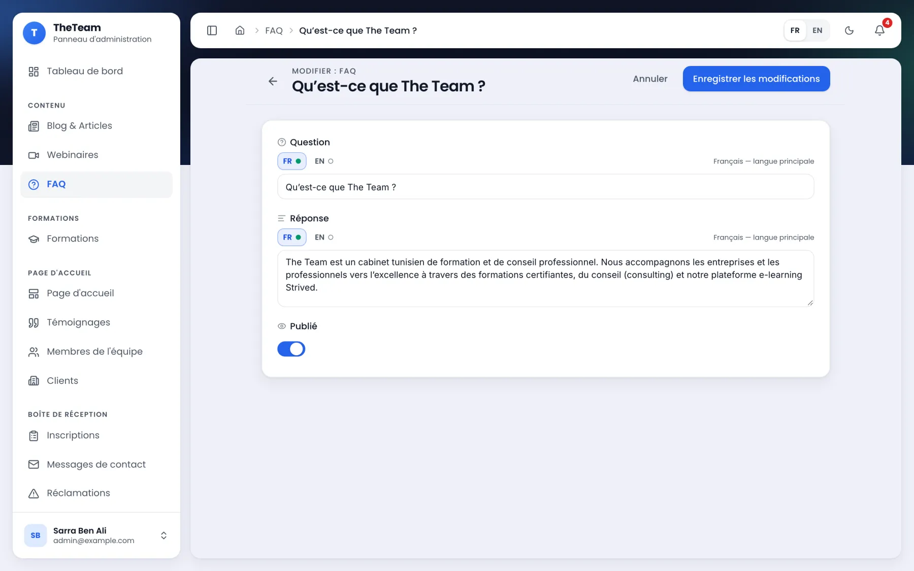
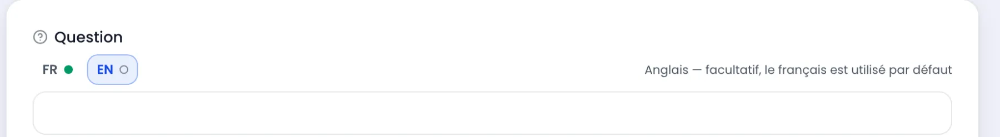
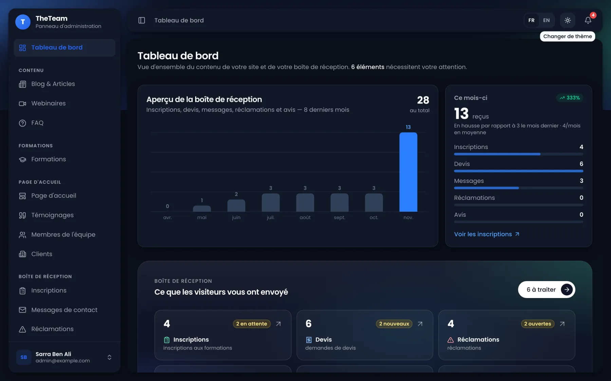

## L’écran principal

Après la connexion, vous arrivez sur le **tableau de bord**. L’écran est toujours organisé de la même façon :

- **à gauche, le menu** : toutes les parties du panneau, rangées par thème (Contenu, Formations, Page d’accueil, Boîte de réception…) ;
- **en haut, la barre d’outils** : où vous êtes, la langue (FR / EN), le mode sombre et la cloche des notifications ;
- **au centre, la page** que vous avez ouverte.

<Frame caption="Le tableau de bord d’un administrateur.">
  
</Frame>

## Le tableau de bord

Il résume l’activité en un coup d’œil :

- **Aperçu de la boîte de réception** : le nombre de demandes reçues (inscriptions, devis, messages, réclamations, avis) pour chacun des 8 derniers mois.
- **Ce mois-ci** : ce que vous avez reçu ce mois-ci, comparé au mois dernier.
- **Ce que les visiteurs vous ont envoyé** : une case par type de demande. Une étiquette orange (« 2 nouveaux », « 3 ouvertes »…) signale ce qui attend un traitement. Cliquez sur une case pour ouvrir la liste correspondante.
- **Ce qui est en ligne sur le site** : le nombre de formations, d’articles, de webinaires… visibles par les visiteurs.

<Frame caption="Plus bas sur le tableau de bord : les demandes reçues et le contenu en ligne.">
  
</Frame>

## Les notifications

Chaque fois qu’un visiteur remplit un formulaire du site (devis, inscription, message, réclamation, avis, témoignage, inscription à la newsletter), **une notification arrive** sur la cloche, en haut à droite. Le chiffre rouge indique le nombre de notifications non lues.

<Frame caption="Cliquez sur la cloche pour voir les dernières demandes. Cliquez sur une demande pour l’ouvrir.">
  
</Frame>

<Tip>
  **Ne ratez plus une demande.** Laissez un onglet du panneau ouvert (même en arrière-plan) : un **son** est joué à chaque nouvelle demande. Dans le menu de la cloche, le bouton **Tester** vérifie le son, et **Activer** affiche aussi une notification de votre ordinateur quand l’onglet n’est pas au premier plan. Si le navigateur indique « Bloquées », autorisez les notifications pour ce site dans les réglages du navigateur (icône à gauche de l’adresse).
</Tip>

**Voir toutes les notifications** ouvre la page complète, où **Tout marquer comme lu** remet le compteur à zéro. Chaque membre de l’équipe a ses propres notifications : ce que vous lisez reste non lu pour vos collègues.

<Frame caption="La page Notifications.">
  
</Frame>

## Les listes

Chaque partie du menu ouvre une **liste**. Elles fonctionnent toutes de la même façon :

<Frame caption="Exemple : la liste des devis.">
  
</Frame>

| Élément | À quoi il sert |
| :-- | :-- |
| **Rechercher** | Tapez un nom, un e-mail, un titre… puis appuyez sur Entrée. |
| **Titres de colonnes** | Cliquez sur un titre (avec les petites flèches) pour trier la liste. |
| **Actifs / Archivés / Tous** | Affiche les éléments en cours, ceux que vous avez archivés, ou tout. |
| **Onglets** (Blogs, Articles, Catégories…) | Certaines parties regroupent plusieurs listes : passez de l’une à l’autre. |
| **Œil** | Voir le détail sans rien modifier. |
| **Crayon** | Modifier. |
| **Boîte** | Archiver (ranger sans supprimer). |
| **Corbeille rouge** | Supprimer — administrateurs seulement. |
| **Tout exporter (CSV)** | Télécharge la liste dans un fichier qui s’ouvre avec Excel. Cochez des lignes pour n’exporter qu’elles. |
| **Par page** | Nombre de lignes affichées ; les pages suivantes sont en bas. |

<Note>
  **Réorganiser l’ordre d’affichage.** Dans certaines listes (FAQ, webinaires, témoignages, équipe, clients), une poignée à six points apparaît au début de chaque ligne. Faites glisser les lignes dans l’ordre voulu, puis cliquez sur **Enregistrer l’ordre** : c’est l’ordre utilisé sur le site.
</Note>

## Archiver ou supprimer ?

- **Archiver** range un élément hors de la liste principale. Rien n’est perdu : il reste visible avec le filtre **Archivés**, et on peut le **désarchiver** à tout moment. Les deux rôles peuvent archiver.
- **Supprimer** efface définitivement. Seuls les **administrateurs** le peuvent. Pour les devis, les messages et les réclamations, il faut **d’abord archiver** avant de pouvoir supprimer.

Chaque action importante demande une confirmation :

<Frame caption="La fenêtre de confirmation. « Non, annuler » ferme la fenêtre sans rien changer.">
  
</Frame>

## Les fiches et formulaires

Cliquez sur un nom ou sur le crayon pour ouvrir la **fiche**. En haut, vous retrouvez toujours :

- la **flèche retour** (←) pour revenir à la liste ;
- les dates **Créé le / Reçu le** et **Dernière mise à jour** ;
- **Annuler** (abandonne vos changements) et **Enregistrer les modifications**.

<Frame caption="Une fiche en modification (ici une question de la FAQ).">
  
</Frame>

<Warning>
  Rien n’est enregistré tant que vous n’avez pas cliqué sur **Enregistrer les modifications** (ou **Créer** pour un nouvel élément). Un message vert confirme l’enregistrement ; un message rouge sous un champ indique ce qu’il faut corriger.
</Warning>

Quelques repères dans les formulaires :

- **LECTURE SEULE** : le champ est affiché pour information mais ne peut pas être modifié (par exemple ce que le visiteur a écrit dans sa demande).
- **RÉSERVÉ AUX ADMINS** : seul un administrateur peut modifier ce champ.
- **Interrupteur bleu** (Publié, Épinglé…) : bleu = activé, gris = désactivé.

## Le français et l’anglais

Le site existe en **français** (langue principale) et en **anglais**. Les textes visibles sur le site ont donc deux onglets, **FR** et **EN** :

<Frame caption="Les onglets FR / EN d’un champ. Le point vert indique que la langue est remplie.">
  
</Frame>

- **Le français est obligatoire**, l’anglais est **facultatif**.
- Si l’anglais est laissé vide, la version anglaise du site affiche le texte français.
- Le sélecteur **FR / EN** de la barre du haut change la langue du panneau **et** l’onglet ouvert par défaut dans les formulaires.

## Le mode sombre

L’icône en forme de lune, en haut à droite, passe le panneau en **mode sombre** (plus reposant le soir). Cliquez à nouveau pour revenir au mode clair. Ce réglage ne change rien au site public.

<Frame caption="Le tableau de bord en mode sombre.">
  
</Frame>
