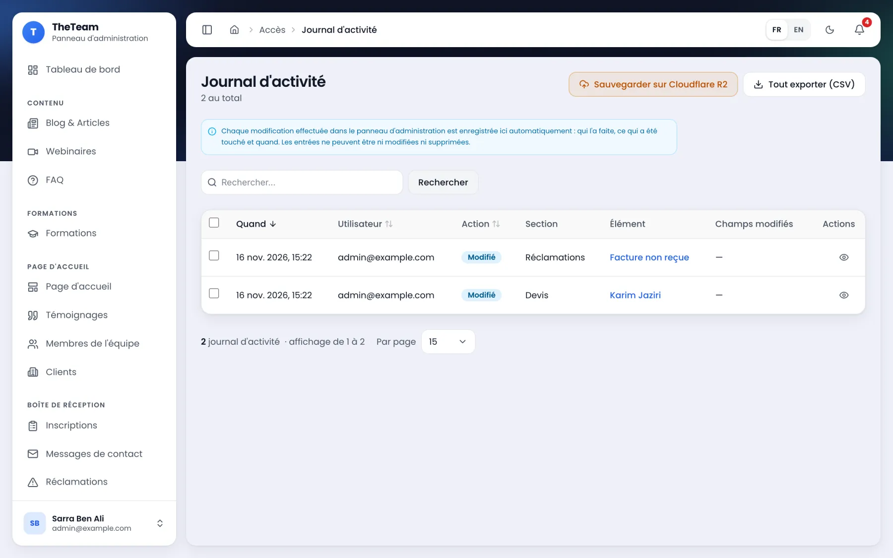
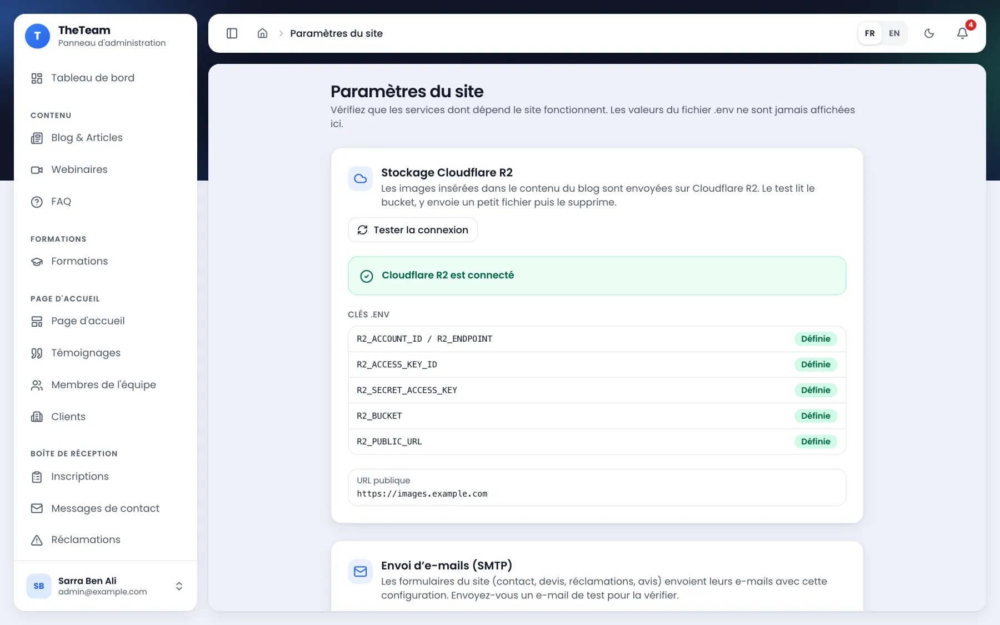
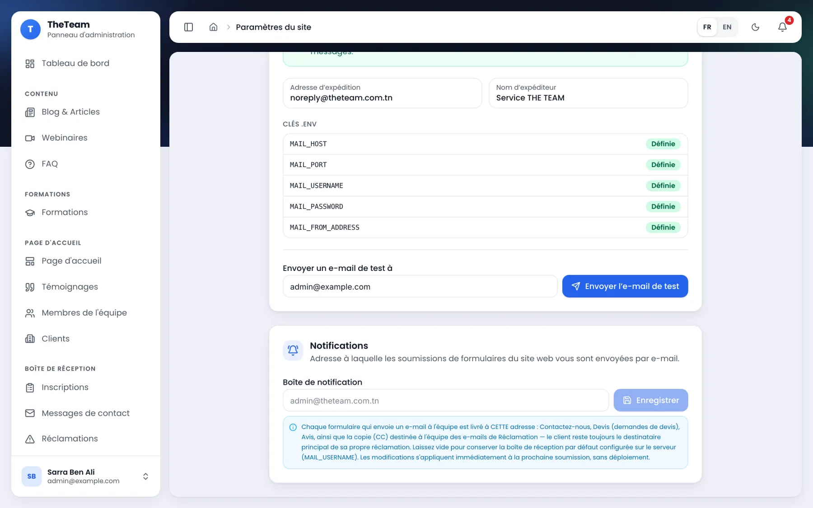
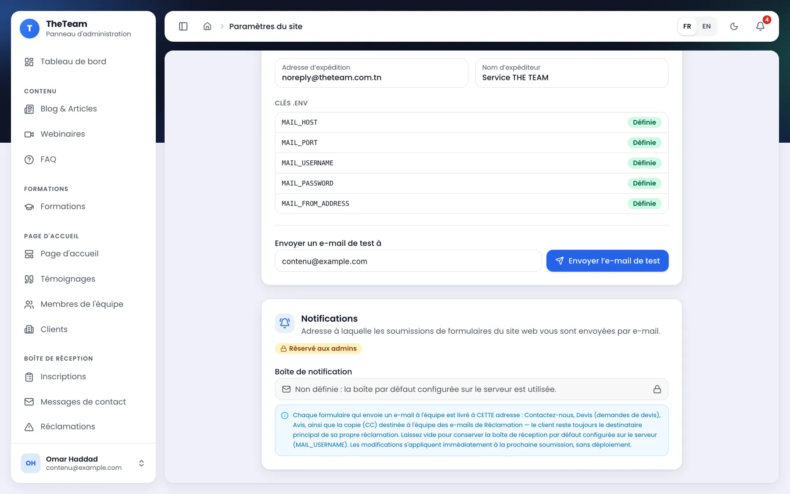

## Le journal d’activité

<Warning>
  **Réservé aux administrateurs.**
</Warning>

Menu **Accès → Journal d’activité**. Chaque modification faite dans le panneau y est enregistrée automatiquement : **quand**, **par qui**, **quelle action** (créé, modifié, archivé, supprimé…), dans **quelle partie** et sur **quel élément**. Personne ne peut modifier ou effacer une ligne du journal.

<Frame caption="Le journal d’activité.">
  
</Frame>

- L’icône œil d’une ligne montre le détail, et pour une modification, **l’ancienne et la nouvelle valeur** de chaque champ.
- **Tout exporter (CSV)** télécharge le journal pour Excel.
- **Sauvegarder sur Cloudflare R2** archive tout le journal dans un fichier sur le stockage en ligne, **puis vide le journal**. Rien n’est effacé si la sauvegarde échoue. Les sauvegardes se récupèrent depuis le tableau de bord Cloudflare (demandez à la personne en charge technique).

## Paramètres du site

Menu **Système → Paramètres du site**. Cette page vérifie que les services dont dépend le site fonctionnent.

| | Administrateur | Gestionnaire de contenu |
| :-- | :-- | :-- |
| Voir la page et lancer les tests | Oui | Oui |
| Changer l’adresse de notification | Oui | Non (lecture seule) |

<Frame caption="Les paramètres du site : le stockage des images (Cloudflare R2), puis l’envoi d’e-mails.">
  
</Frame>

### Stockage Cloudflare R2

C’est là que sont rangées les images insérées dans les articles du blog. Un cadre **vert** « Cloudflare R2 est connecté » signifie que tout va bien. **Tester la connexion** fait un essai complet.

### Envoi d’e-mails (SMTP)

C’est le service qui envoie les e-mails des formulaires du site (contact, devis, réclamations, avis). Pour le vérifier, saisissez votre adresse dans **Envoyer un e-mail de test à**, cliquez sur **Envoyer l’e-mail de test** et regardez votre boîte de réception.

<Card title="Envoi d’e-mails (SMTP) : le guide complet" icon="paper-plane" href="/guide-utilisateur/envoi-emails-smtp" horizontal>
  Lire l’état de la carte, envoyer un e-mail de test et comprendre chaque message d’erreur.
</Card>

### Notifications : l’adresse qui reçoit les formulaires

La **Boîte de notification** est l’adresse e-mail de l’équipe qui reçoit les formulaires du site : Contactez-nous, Devis, Avis, et la copie des réclamations.

<Frame caption="La carte Notifications (administrateur).">
  
</Frame>

Pour la changer : cliquez sur **Modifier**, saisissez la nouvelle adresse et cliquez sur **Enregistrer**. Le changement s’applique immédiatement. Laissée vide, l’adresse par défaut du serveur est utilisée.

<Frame caption="La même carte vue par un gestionnaire de contenu : en lecture seule, marquée « Réservé aux admins ».">
  
</Frame>

<Warning>
  **Un cadre rouge ou orange sur cette page ?** Les clés techniques (affichées seulement par leur nom, jamais leur valeur) sont à compléter sur le serveur. Ce n’est pas réglable depuis le panneau : prévenez la personne en charge technique du site, avec une capture de l’écran.
</Warning>
