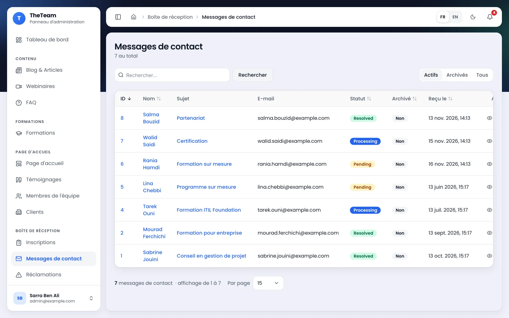
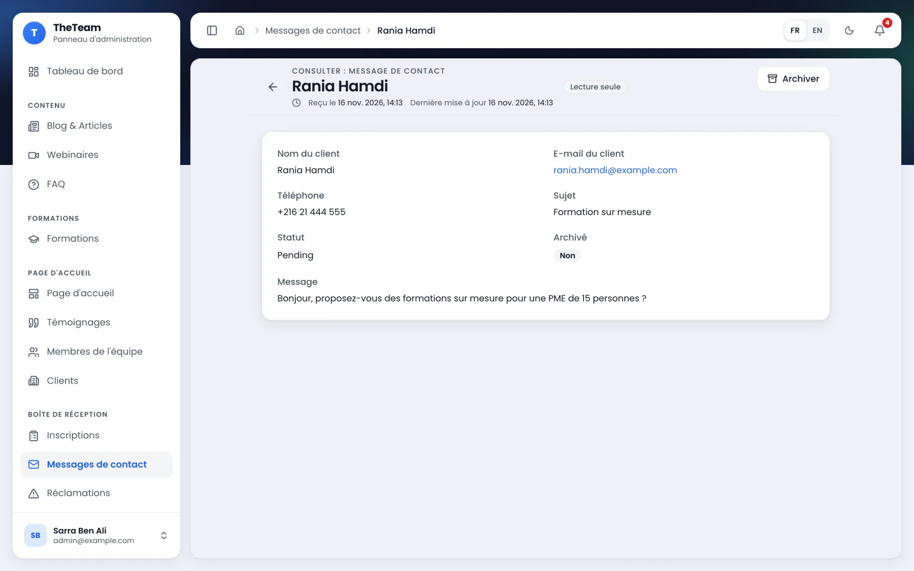
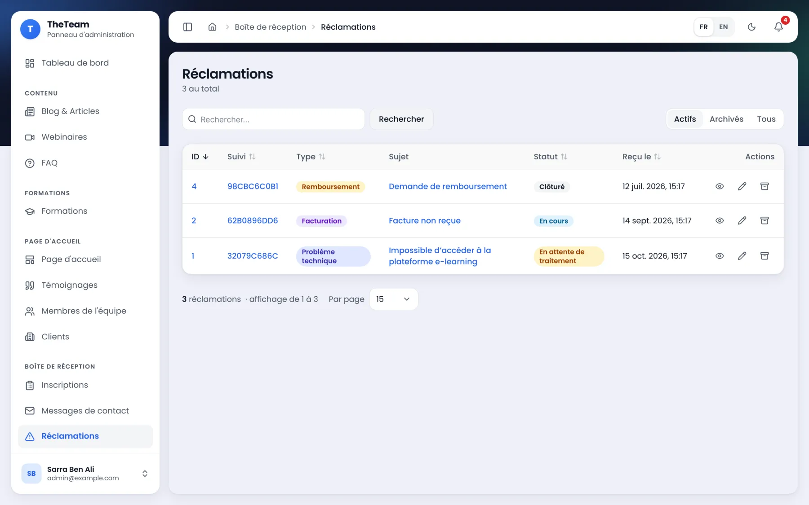
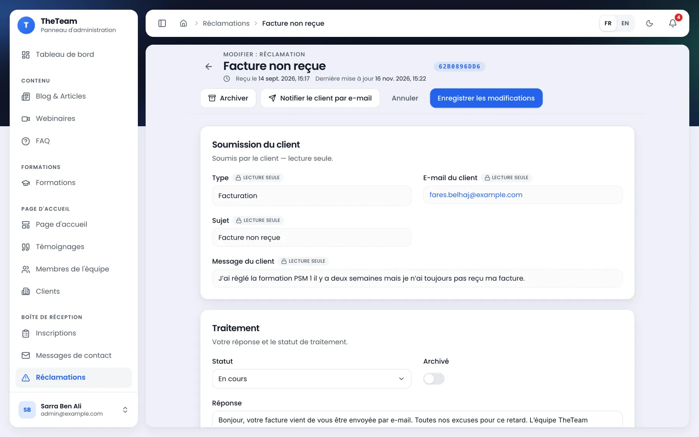
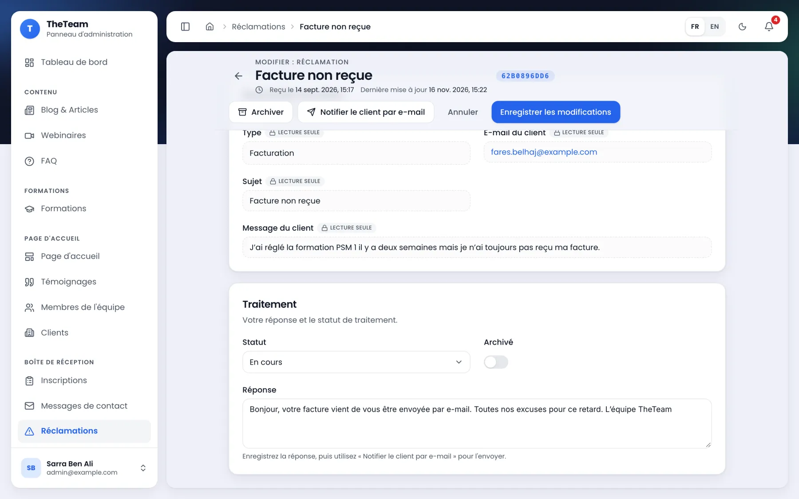

## Les messages de contact

Menu **Boîte de réception → Messages de contact** : les messages envoyés avec le formulaire **Contactez-nous** du site. Une copie arrive aussi par e-mail à l’équipe.

<Info>
  **Les deux rôles** peuvent lire et archiver les messages. Seul un **administrateur** peut supprimer un message, et seulement après l’avoir archivé.
</Info>

<Frame caption="La liste des messages de contact.">
  
</Frame>

Les messages sont en **lecture seule** : ouvrez-en un (icône œil) pour lire le nom, l’e-mail, le téléphone, le sujet et le message, puis **répondez directement depuis votre messagerie** à l’adresse indiquée. Une fois le message traité, cliquez sur **Archiver**.

<Frame caption="Un message de contact ouvert.">
  
</Frame>

## Les réclamations

Menu **Boîte de réception → Réclamations**. Un client qui a un problème (remboursement, facturation, problème technique…) remplit le formulaire **Réclamation** du site. Il reçoit un **numéro de suivi** (par exemple `6280896D06`) qui lui permet de suivre l’avancement sur le site.

<Info>
  **Les deux rôles** peuvent répondre, changer le statut, prévenir le client et archiver. Seul un **administrateur** peut supprimer, après archivage.
</Info>

<Frame caption="La liste des réclamations, avec le numéro de suivi, le type et le statut.">
  
</Frame>

### Les statuts

| Statut | Signification |
| :-- | :-- |
| **En attente de traitement** | Personne ne l’a encore traitée. |
| **En cours de traitement** | Quelqu’un s’en occupe. |
| **Résolue** | Le problème est réglé. |
| **Clôturée** | Le dossier est fermé. |

Le client voit ce statut, et votre réponse, en suivant sa réclamation sur le site avec son numéro.

### Répondre à une réclamation

<Steps>
  <Step title="Ouvrez la réclamation">
    En haut, la section **Soumission du client** (lecture seule) montre le type, l’e-mail, le sujet et le message du client.
  </Step>
  <Step title="Écrivez votre réponse">
    Dans la section **Traitement**, rédigez la **Réponse** et choisissez le **Statut**.
  </Step>
  <Step title="Enregistrez">
    Cliquez sur **Enregistrer les modifications**.
  </Step>
  <Step title="Prévenez le client">
    Cliquez sur **Notifier le client par e-mail** : le client reçoit votre réponse par e-mail, et l’équipe en copie.
  </Step>
</Steps>

<Frame caption="La fiche d’une réclamation. Le numéro de suivi est affiché à côté du titre.">
  
</Frame>

<Frame caption="La section Traitement : statut et réponse.">
  
</Frame>

<Warning>
  **Enregistrez d’abord, notifiez ensuite.** Le bouton **Notifier le client par e-mail** envoie la réponse **enregistrée**. S’il n’y a pas encore de réponse enregistrée, le panneau vous le signale et n’envoie rien.
</Warning>

Quand le dossier est clos, cliquez sur **Archiver** pour le ranger.
