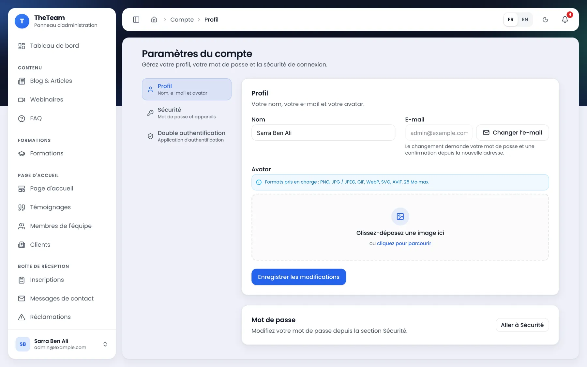
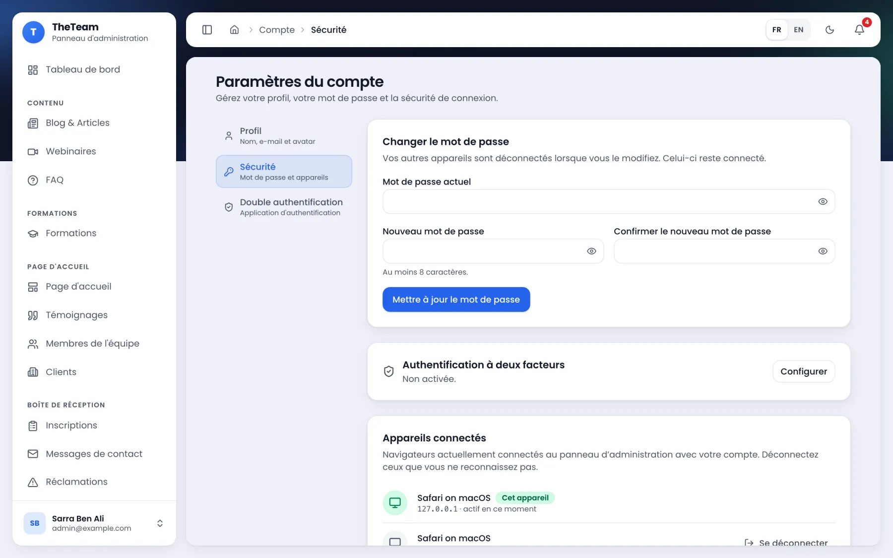
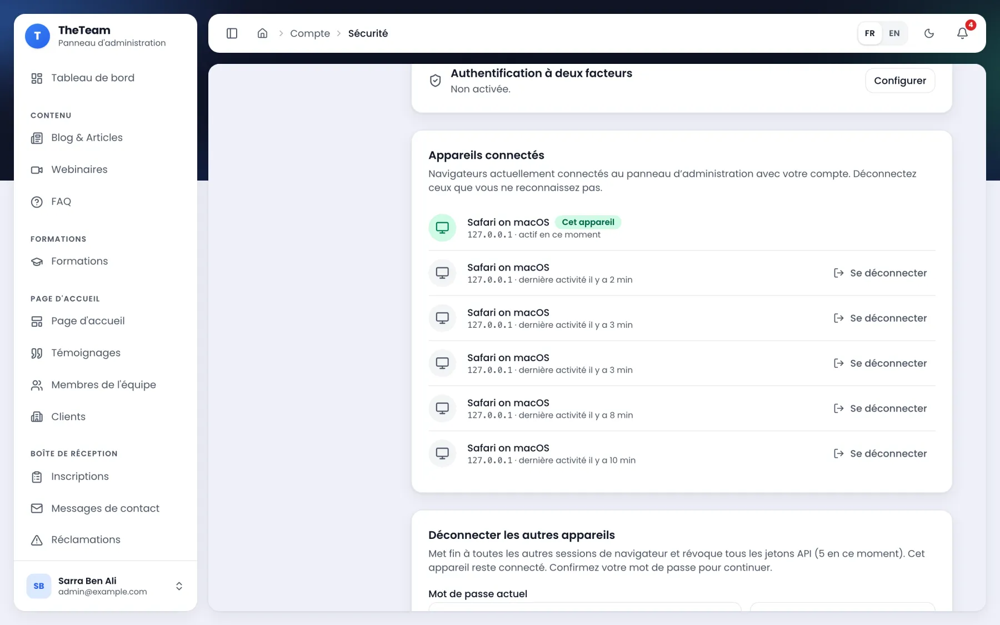
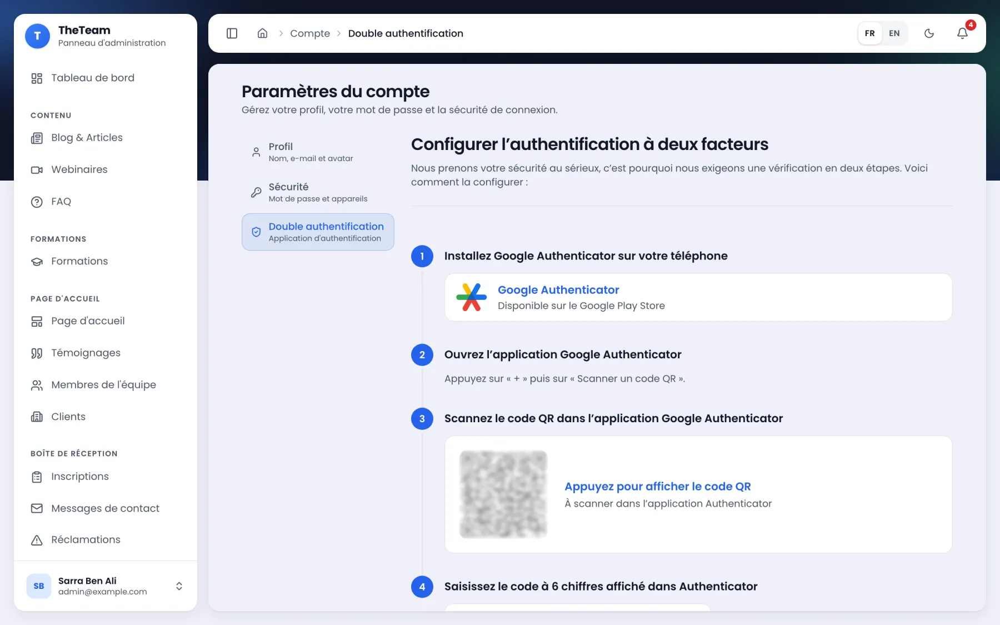

Vos réglages personnels se trouvent dans **Paramètres du compte** : cliquez sur votre nom en bas du menu de gauche, puis sur **Paramètres du compte** (les gestionnaires de contenu ont aussi l’entrée **Mon profil** dans le menu). La page a trois onglets : **Profil**, **Sécurité** et **Double authentification**.

## Profil : nom, e-mail et photo

<Frame caption="L’onglet Profil.">
  
</Frame>

- **Nom** : il apparaît dans le menu et comme auteur de vos articles.
- **Avatar** : glissez une photo dans le cadre, ou cliquez dedans pour la choisir.
- Cliquez sur **Enregistrer les modifications**.

**Changer d’adresse e-mail** : cliquez sur **Changer l’e-mail**, saisissez la nouvelle adresse et votre mot de passe. Un e-mail de confirmation est envoyé à la **nouvelle** adresse : le changement n’a lieu qu’après avoir cliqué sur son lien.

## Sécurité : mot de passe et appareils

<Frame caption="L’onglet Sécurité.">
  
</Frame>

**Changer le mot de passe** : saisissez le mot de passe actuel, puis deux fois le nouveau (au moins 8 caractères), et cliquez sur **Mettre à jour le mot de passe**. Vos autres appareils sont alors déconnectés ; celui que vous utilisez reste connecté.

Plus bas, **Appareils connectés** liste les navigateurs connectés à votre compte.

<Frame caption="Les appareils connectés. « Cet appareil » est celui que vous utilisez en ce moment.">
  
</Frame>

- **Se déconnecter** sur une ligne : déconnecte cet appareil précis.
- **Déconnecter les autres appareils** : garde seulement celui-ci (votre mot de passe est demandé).
- **Se déconnecter partout** : déconnecte tout, y compris cet appareil.

<Warning>
  Vous voyez un appareil que vous ne reconnaissez pas ? Déconnectez-le, **changez votre mot de passe** et prévenez un administrateur.
</Warning>

## La double authentification

La double authentification ajoute un **code à 6 chiffres**, affiché sur votre téléphone, au moment de la connexion. Même si quelqu’un découvre votre mot de passe, il ne peut pas entrer sans votre téléphone. **Nous la recommandons à tous.**

<Frame caption="L’onglet Double authentification, avant activation.">
  
</Frame>

<Steps>
  <Step title="Installez Google Authenticator">
    Application gratuite, sur le Google Play Store ou l’App Store.
  </Step>
  <Step title="Scannez le code QR">
    Dans l’application, appuyez sur **+** puis **Scanner un code QR**. Sur la page, cliquez sur **Appuyez pour afficher le code QR** et visez-le avec le téléphone.
  </Step>
  <Step title="Saisissez le code à 6 chiffres">
    Tapez le code affiché dans l’application, puis cliquez sur **Activer**.
  </Step>
  <Step title="Gardez vos codes de secours">
    Des **codes de secours** s’affichent. Notez-les et gardez-les en lieu sûr : chacun permet de se connecter une fois si vous perdez votre téléphone.
  </Step>
</Steps>

À chaque connexion, après le mot de passe, il suffit d’ouvrir l’application et de taper le code du moment.
