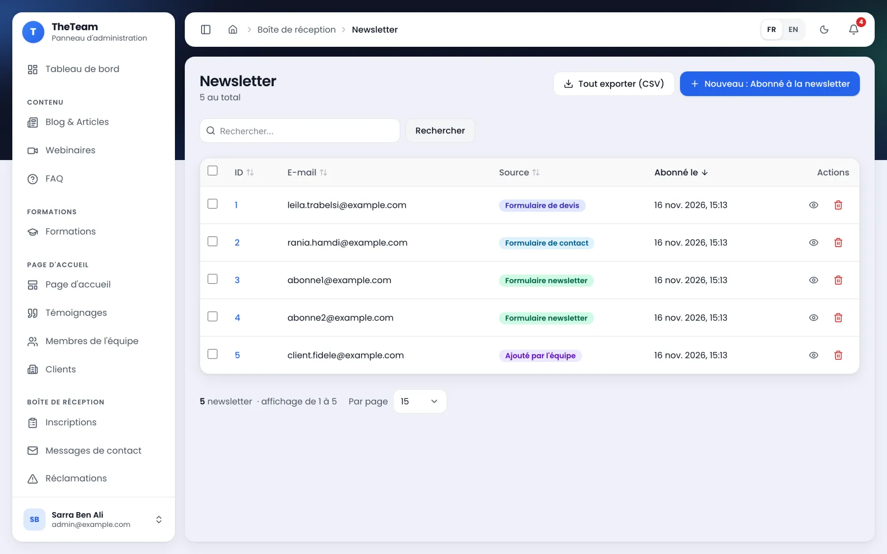
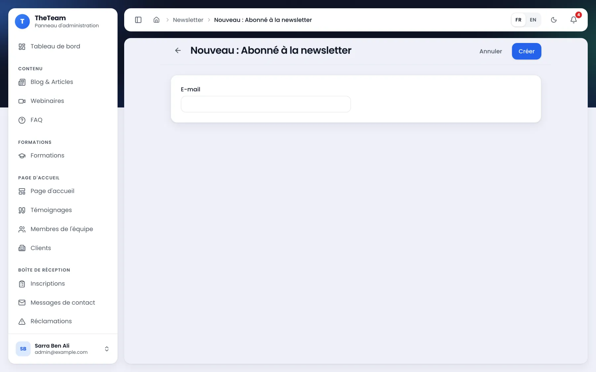
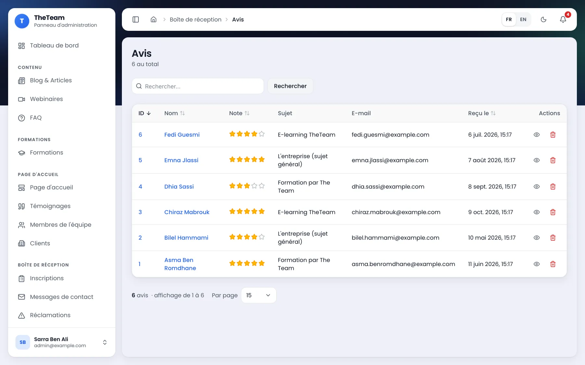
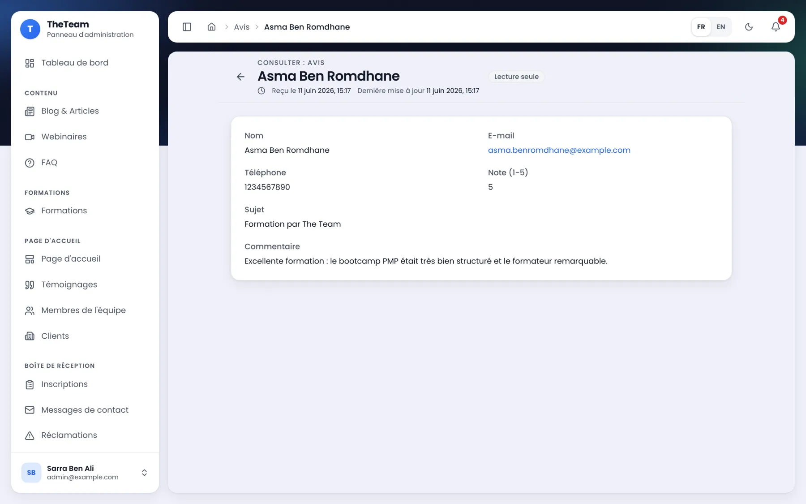

## La newsletter

Menu **Boîte de réception → Newsletter** : toutes les adresses e-mail qui ont accepté de recevoir vos actualités.

<Info>
  **Les deux rôles** peuvent consulter la liste, ajouter une adresse et exporter. Seul un **administrateur** peut supprimer une adresse.
</Info>

<Tip>
  Pour voir l’inscription à la newsletter tel que le visiteur le remplit sur le site, consultez [Newsletter](/guide-utilisateur/formulaire-newsletter) (côté visiteur).
</Tip>

<Frame caption="La liste des abonnés. La colonne Source indique d’où vient chaque adresse.">
  
</Frame>

La liste se remplit toute seule. La colonne **Source** indique l’origine de chaque adresse :

| Source | D’où vient l’adresse |
| :-- | :-- |
| Formulaire newsletter | Le visiteur s’est inscrit à la newsletter. |
| Formulaire de devis | Il a demandé un devis. |
| Formulaire de contact | Il a envoyé un message de contact. |
| Formulaire de réclamation | Il a envoyé une réclamation. |
| Ajouté par l’équipe | Quelqu’un l’a ajoutée à la main dans le panneau. |

**Ajouter une adresse** : **Nouveau : Abonné à la newsletter**, saisissez l’e-mail et cliquez sur **Créer**.

<Frame caption="Ajouter une adresse à la main.">
  
</Frame>

**Exporter** : **Tout exporter (CSV)** télécharge la liste (e-mail, source, date) pour l’importer dans votre outil d’envoi d’e-mails. Cochez des lignes pour n’exporter qu’elles.

<Note>
  Un abonné qui se désinscrit depuis le site est retiré automatiquement de cette liste.
</Note>

## Les avis

Menu **Boîte de réception → Avis** : les avis laissés par les visiteurs (note sur 5, sujet et commentaire).

<Info>
  **Les deux rôles** peuvent lire les avis. Seul un **administrateur** peut en supprimer un.
</Info>

<Frame caption="La liste des avis, avec la note en étoiles.">
  
</Frame>

Les avis sont en **lecture seule** : ils ne sont pas modifiables. Ouvrez-en un (icône œil) pour lire le commentaire en entier. Sur le tableau de bord, la case **Avis** affiche aussi la note moyenne.

<Frame caption="Un avis ouvert.">
  
</Frame>

<Tip>
  Un avis très positif ? Proposez à son auteur d’envoyer un **témoignage** depuis le site : il pourra alors être publié sur la page d’accueil (voir [Page d’accueil](/guide-utilisateur/page-accueil)).
</Tip>
