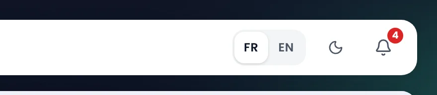
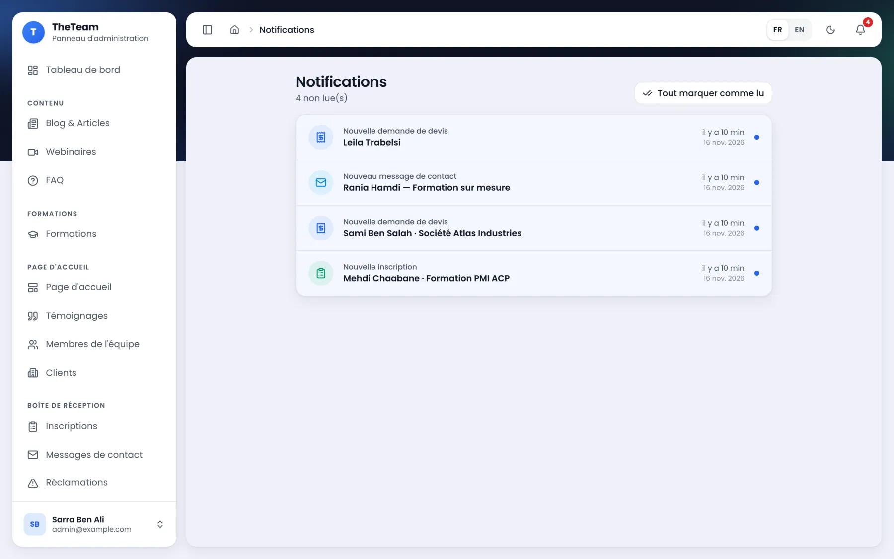
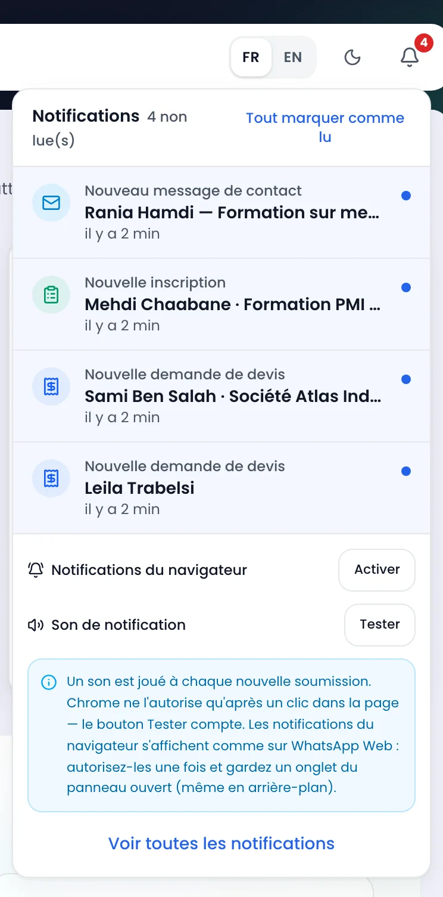
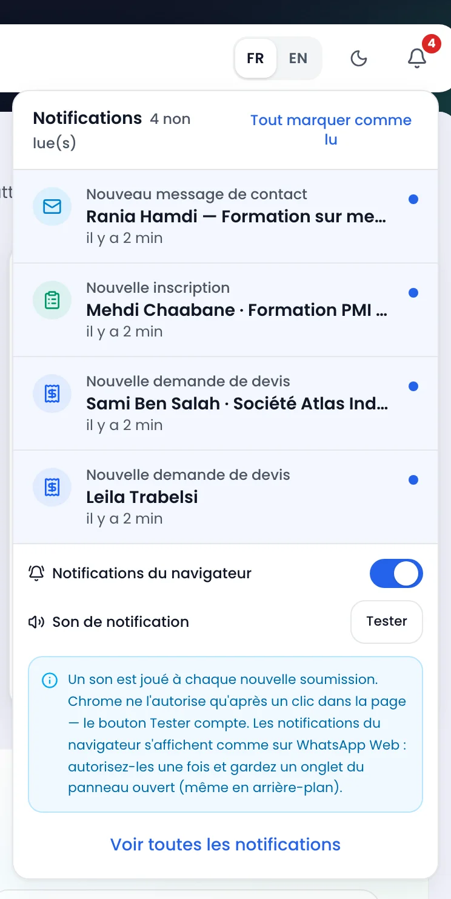
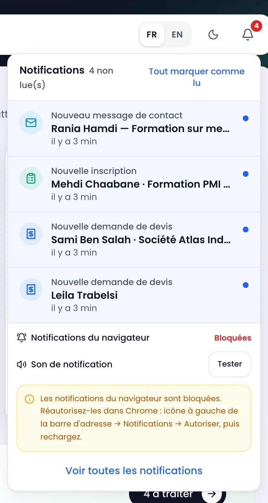

Chaque fois qu’un visiteur remplit un formulaire du site, le panneau vous prévient. Cette page explique **où voir ces notifications** et **comment les activer** pour être alerté même quand vous travaillez dans une autre fenêtre.

<Info>
  Les notifications concernent **les deux rôles** : administrateurs et gestionnaires de contenu. Chacun a les siennes : ce que vous lisez reste non lu pour vos collègues.
</Info>

## Ce qui déclenche une notification

| Formulaire rempli sur le site | Notification reçue |
| :-- | :-- |
| Demande de devis | **Nouvelle demande de devis** |
| Inscription à une formation | **Nouvelle inscription** |
| Formulaire de contact | **Nouveau message de contact** |
| Réclamation | **Nouvelle réclamation** |
| Avis | **Nouvel avis** |
| Inscription à la newsletter | **Nouvel abonné à la newsletter** |
| Témoignage | **Nouveau témoignage** |

## La cloche, en haut à droite

La cloche se trouve **en haut à droite** de toutes les pages du panneau. Le **chiffre rouge** indique combien de notifications vous n’avez pas encore lues. Le panneau vérifie les nouvelles demandes **toutes les 25 secondes environ**, et aussi dès que vous revenez sur l’onglet : inutile de recharger la page.

<Frame caption="La cloche avec 4 notifications non lues.">
  
</Frame>

Cliquez sur la cloche pour ouvrir le menu :

- les **dernières demandes**, les non lues en gras avec un point bleu ;
- **cliquez sur une demande** pour l’ouvrir directement : elle passe en « lue » ;
- **Tout marquer comme lu** remet le compteur à zéro ;
- **Voir toutes les notifications** ouvre la page complète, avec l’historique.

<Frame caption="La page Notifications (bouton « Voir toutes les notifications »).">
  
</Frame>

## Les deux alertes à activer

En bas du menu de la cloche, deux lignes règlent la façon dont vous êtes prévenu :

| Alerte | Ce qu’elle fait | Quand |
| :-- | :-- | :-- |
| **Son de notification** | Joue un petit son à chaque nouvelle demande. | Dès qu’un onglet du panneau est ouvert. |
| **Notifications du navigateur** | Affiche une bulle de votre ordinateur (comme WhatsApp Web), avec le type de demande et le nom du visiteur. | Quand le panneau est ouvert mais que vous êtes sur un autre onglet ou une autre application. |

<Frame caption="Le menu de la cloche avant activation : le bouton « Activer » et le bouton « Tester ».">
  
</Frame>

## Activer les notifications (à faire une fois par ordinateur)

<Steps>
  <Step title="Ouvrez le panneau dans Google Chrome">
    Chrome est recommandé (Edge et Firefox fonctionnent de la même façon). Connectez-vous au panneau.
  </Step>
  <Step title="Cliquez sur la cloche, en haut à droite">
    Le menu des notifications s’ouvre.
  </Step>
  <Step title="Cliquez sur « Activer », à droite de « Notifications du navigateur »">
    Le navigateur affiche une petite fenêtre près de la barre d’adresse : « admin.theteam.com.tn souhaite afficher des notifications ». Cliquez sur **Autoriser**.
  </Step>
  <Step title="Vérifiez la bulle de confirmation">
    Une notification **« Notifications activées »** apparaît sur votre écran : « Vous serez désormais averti ici quand un visiteur envoie un formulaire. » Dans le menu, le bouton **Activer** est remplacé par un **interrupteur bleu**.
  </Step>
  <Step title="Cliquez sur « Tester », à droite de « Son de notification »">
    Vous devez entendre le son. Ce clic débloque aussi le son pour la suite : les navigateurs n’autorisent un son qu’après un premier clic dans la page.
  </Step>
  <Step title="Gardez un onglet du panneau ouvert">
    Il peut rester **en arrière-plan** ou dans une fenêtre réduite. Vous pouvez travailler dans d’autres onglets ou d’autres applications : le son et la bulle vous préviendront.
  </Step>
</Steps>

<Frame caption="Les notifications sont activées : l’interrupteur est bleu.">
  
</Frame>

### Quand une demande arrive

- **Vous êtes sur le panneau** : le chiffre de la cloche augmente et le son est joué. Pas de bulle, puisque vous voyez déjà la cloche.
- **Vous êtes sur un autre onglet ou une autre application** : une bulle de l’ordinateur s’affiche (par exemple « Nouvelle demande de devis — Sami Ben Salah · Société Atlas Industries »), en plus du son. **Cliquez sur la bulle** : le panneau s’ouvre directement sur la demande.
- **Plusieurs demandes d’un coup** : une seule bulle les résume, « 3 nouvelles soumissions — Ouvrez le panneau d’administration pour les voir. »

### Mettre les bulles en pause

L’interrupteur bleu coupe ou remet les bulles **sur ce navigateur**, sans rien changer à l’autorisation. Le réglage est propre à chaque ordinateur et à chaque navigateur : refaites l’activation sur chaque poste où vous travaillez.

## Le navigateur affiche « Bloquées »

Si vous avez cliqué sur **Bloquer** (ou fermé la fenêtre d’autorisation), le menu affiche **Bloquées** en rouge et un cadre orange. Le bouton « Activer » ne peut plus redemander l’autorisation : il faut la rétablir dans le navigateur.

<Frame caption="Les notifications du navigateur sont bloquées.">
  
</Frame>

<Steps>
  <Step title="Cliquez sur l’icône à gauche de l’adresse">
    Dans Chrome, l’icône de réglages (deux petits curseurs) juste avant `admin.theteam.com.tn`.
  </Step>
  <Step title="Passez « Notifications » sur « Autoriser »">
    Si la ligne n’apparaît pas, cliquez sur **Paramètres du site** et cherchez **Notifications**.
  </Step>
  <Step title="Rechargez la page">
    Touche **F5** (ou **Cmd + R** sur Mac). Le menu de la cloche affiche maintenant l’interrupteur.
  </Step>
</Steps>

## Le son ne se fait pas entendre

Le menu affiche alors un cadre orange « Le navigateur a bloqué le son ».

- Cliquez une fois sur **Tester** dans le menu de la cloche : cela suffit le plus souvent.
- Sinon, dans Chrome : icône à gauche de l’adresse → **Paramètres du site** → **Son** → **Autoriser**.
- Vérifiez aussi que le son de l’ordinateur n’est pas coupé et que l’onglet n’est pas mis en sourdine (clic droit sur l’onglet).

## Aucune bulle n’apparaît alors que tout est activé

L’ordinateur lui-même peut bloquer les bulles du navigateur :

<Tabs>
  <Tab title="Windows">
    **Paramètres → Système → Notifications** : vérifiez que les notifications sont activées et que **Google Chrome** est autorisé. Désactivez aussi l’**Assistant de concentration** (« Ne pas déranger ») pendant vos heures de travail.
  </Tab>
  <Tab title="Mac">
    **Réglages Système → Notifications → Google Chrome** : activez **Autoriser les notifications**. Vérifiez qu’aucun mode **Concentration** (« Ne pas déranger ») n’est actif.
  </Tab>
</Tabs>

<Warning>
  **Le navigateur doit rester ouvert.** Si tous les onglets du panneau sont fermés, ou si l’ordinateur est éteint, vous n’êtes pas alerté. Rien n’est perdu pour autant : les demandes vous attendent dans la cloche et dans la **Boîte de réception**, et l’équipe reçoit aussi par e-mail les formulaires de contact, de devis, d’avis et de réclamation.
</Warning>

## En résumé

<Check>
  1. Cliquez sur la cloche, puis sur **Activer** et sur **Autoriser**.
  2. Cliquez sur **Tester** pour débloquer le son.
  3. Gardez un onglet du panneau ouvert, même en arrière-plan.
</Check>
