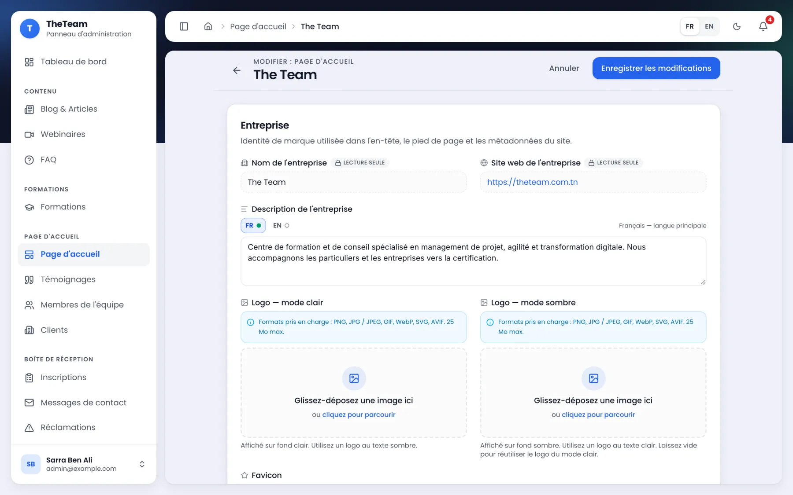
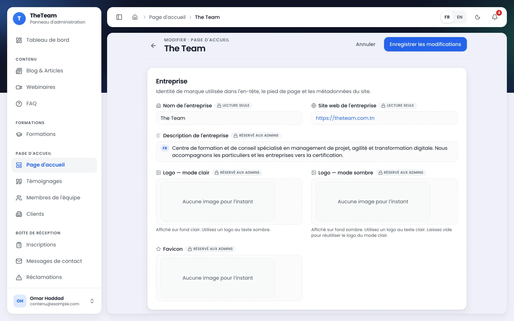
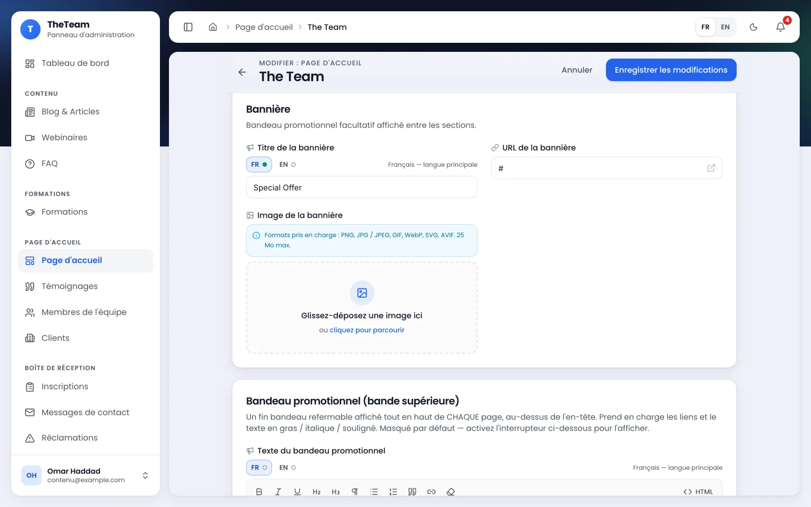
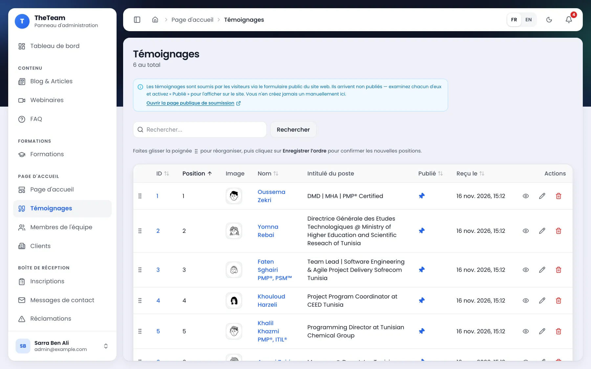
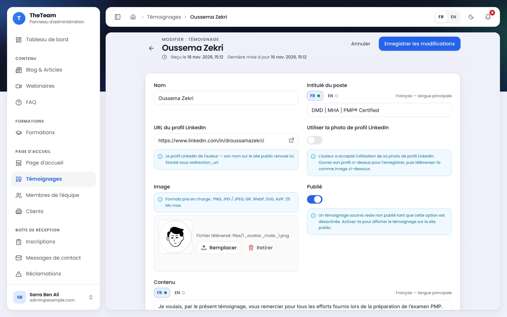
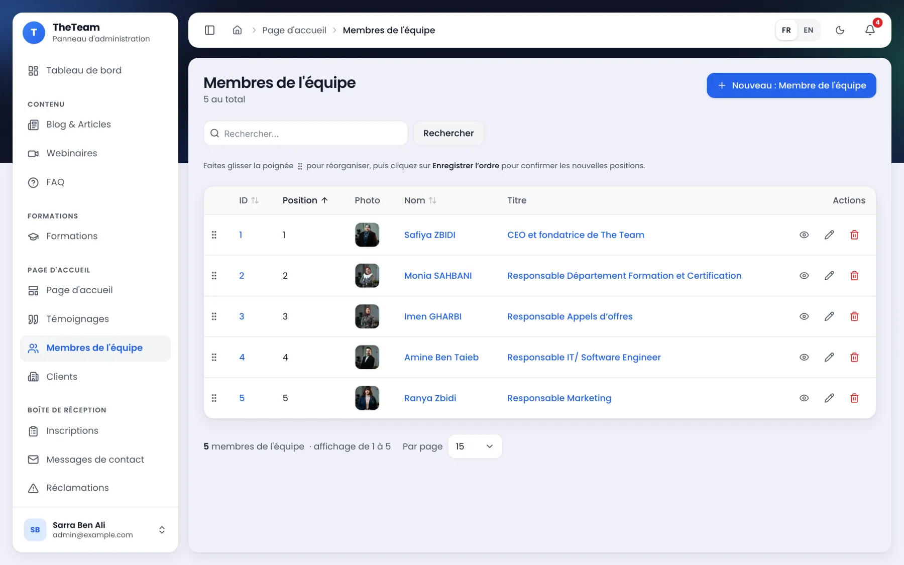
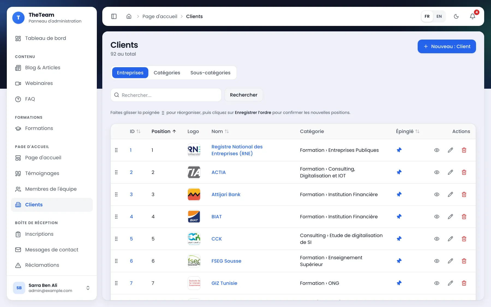

Le groupe **Page d’accueil** du menu contient quatre parties : **Page d’accueil**, **Témoignages**, **Membres de l’équipe** et **Clients**.

| Partie | Administrateur | Gestionnaire de contenu |
| :-- | :-- | :-- |
| Page d’accueil | Tout modifier | Seulement le **bandeau promo** et la **bannière** |
| Témoignages | Tout | Consulter, modifier, publier |
| Membres de l’équipe | Tout | Consulter seulement |
| Clients | Tout | Créer et modifier |

## La page d’accueil

Menu **Page d’accueil**, puis le crayon. Il n’y a qu’une seule fiche, découpée en sections :

| Section | Contenu |
| :-- | :-- |
| **Entreprise** | Nom, description, logos (mode clair / sombre), icône du site. |
| **En-tête / Hero** | Le grand titre en haut de la page d’accueil, son sous-titre et son bouton. |
| **Bannière** | Une bande promotionnelle facultative (titre, lien, image) entre deux sections. |
| **Bandeau promotionnel** | Un fin bandeau tout en haut de **chaque** page du site. |
| **Coordonnées** | Adresse, téléphones, e-mail de contact (pied de page). |
| **Applications mobiles** | Liens App Store et Google Play. |
| **Réseaux sociaux** | Facebook, Instagram, LinkedIn, YouTube, X, WhatsApp, Google Maps. |
| **Intégrations — agenda** | Le Google Agenda intégré au site. |

<Frame caption="La fiche de la page d’accueil, vue par un administrateur.">
  
</Frame>

### Ce que voit le gestionnaire de contenu

Le gestionnaire de contenu voit toute la fiche, mais seules la **Bannière** et le **Bandeau promotionnel** sont modifiables. Les autres champs portent l’étiquette **RÉSERVÉ AUX ADMINS**.

<Frame caption="Vue du gestionnaire de contenu : les champs de l’entreprise sont verrouillés.">
  
</Frame>

### Le bandeau promo et la bannière

<Frame caption="Les sections Bannière et Bandeau promotionnel, modifiables par les deux rôles.">
  
</Frame>

- **Bandeau promotionnel** : écrivez le texte (gras, italique et liens possibles), puis activez **Afficher le bandeau promotionnel**. Désactivez-le pour le masquer sans effacer le texte.
- **Bannière** : un titre, un lien (la page ouverte au clic) et une image. Laissez-la vide si vous n’en voulez pas.

N’oubliez pas **Enregistrer les modifications**.

## Les témoignages

Menu **Témoignages**. Les témoignages sont **envoyés par les visiteurs** depuis un formulaire du site (le lien **Ouvrir la page publique de soumission** l’ouvre). Ils arrivent **non publiés** : vous les relisez, puis vous décidez de les afficher.

<Frame caption="La liste des témoignages. La colonne Publié indique ceux qui sont visibles sur le site.">
  
</Frame>

<Steps>
  <Step title="Ouvrez le témoignage">
    Cliquez sur le crayon. Une notification vous prévient à chaque nouveau témoignage.
  </Step>
  <Step title="Relisez-le">
    Corrigez si besoin une faute de frappe dans le contenu ou l’intitulé du poste.
  </Step>
  <Step title="Ajoutez la photo (si l’auteur l’a accepté)">
    Si **Utiliser la photo de profil LinkedIn** est activé, ouvrez son profil avec le lien, enregistrez la photo, puis envoyez-la dans **Image**.
  </Step>
  <Step title="Publiez">
    Activez **Publié** et enregistrez.
  </Step>
</Steps>

<Frame caption="La fiche d’un témoignage.">
  
</Frame>

Pour choisir l’ordre d’affichage, faites glisser les lignes de la liste puis cliquez sur **Enregistrer l’ordre**.

## Les membres de l’équipe

Menu **Membres de l’équipe** : les personnes présentées sur le site (photo, nom, titre). L’administrateur peut en ajouter, les modifier et changer leur ordre ; le gestionnaire de contenu peut seulement les consulter.

<Frame caption="La liste des membres de l’équipe.">
  
</Frame>

## Les clients

Menu **Clients** : les logos des entreprises et organismes clients. Trois onglets :

- **Entreprises** : chaque client (nom, description, catégorie, logo, site web, Épinglé) ;
- **Catégories** et **Sous-catégories** : le classement des clients (par exemple *Formation › Institution financière*).

<Frame caption="La liste des clients.">
  
</Frame>

Pour ajouter un client : **Nouveau : Client**, remplissez le nom, choisissez la catégorie, ajoutez le logo et enregistrez.
