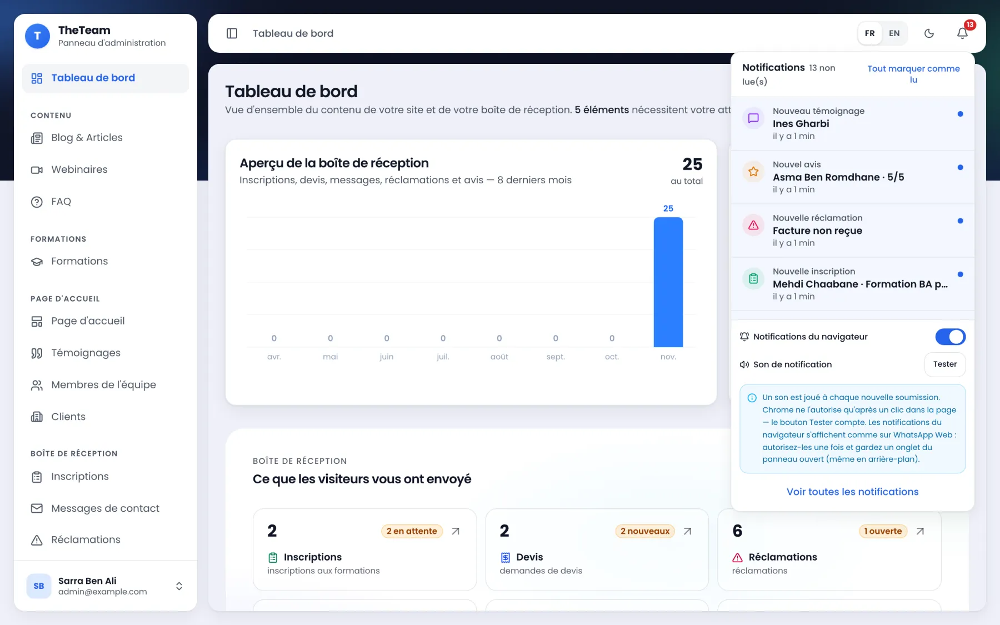
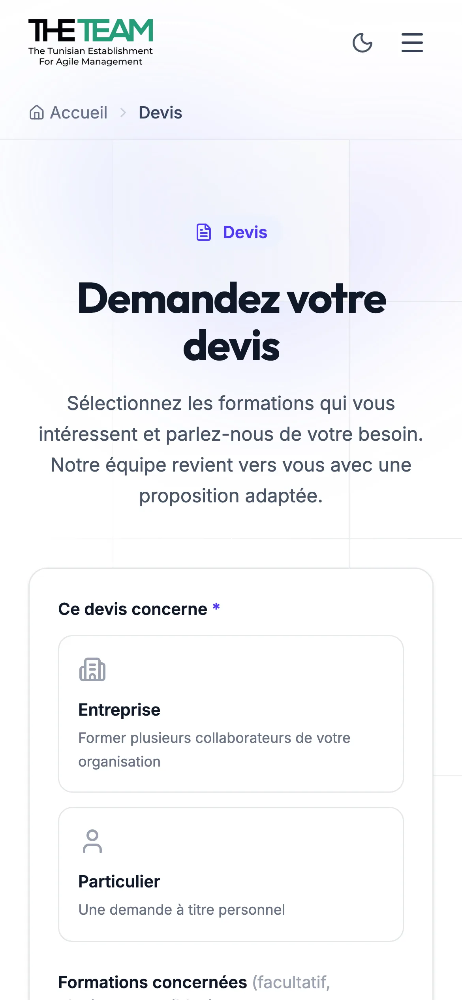

Pour bien traiter une demande, il aide de savoir **ce que le visiteur a vu et rempli**. Cette partie du guide montre chaque formulaire du site **theteam.com.tn**, tel qu’il apparaît au visiteur, puis ce qu’il voit après l’envoi.

## Le chemin d’une demande

<Steps>
  <Step title="Le visiteur remplit un formulaire sur le site">
    Par exemple la page **Devis**. Les champs marqués d’un astérisque (*) sont obligatoires.
  </Step>
  <Step title="Il voit un message de confirmation">
    Le site lui confirme que sa demande est bien partie.
  </Step>
  <Step title="Le panneau vous prévient">
    Une notification arrive sur la **cloche**, avec un son (voir [Notifications](/guide-utilisateur/notifications)). Pour certains formulaires, l’équipe reçoit aussi un e-mail.
  </Step>
  <Step title="Vous traitez la demande">
    Elle vous attend dans la **Boîte de réception** du panneau.
  </Step>
</Steps>

<Frame caption="Côté équipe : les demandes envoyées depuis le site arrivent aussitôt dans la cloche du panneau.">
  
</Frame>

## Les formulaires du site

| Formulaire | Adresse sur le site | Arrive dans le panneau | E-mail envoyé |
| :-- | :-- | :-- | :-- |
| [Devis](/guide-utilisateur/formulaire-devis) | theteam.com.tn/devis | Boîte de réception → **Devis** | À l’équipe |
| [Inscription](/guide-utilisateur/formulaire-inscription) | theteam.com.tn/enrollment | Boîte de réception → **Inscriptions** | — |
| [Contact](/guide-utilisateur/formulaire-contact) | theteam.com.tn/contact-us | Boîte de réception → **Messages de contact** | À l’équipe |
| [Réclamation](/guide-utilisateur/formulaire-reclamation) | theteam.com.tn/reclamation | Boîte de réception → **Réclamations** | Au client, équipe en copie |
| [Avis](/guide-utilisateur/formulaire-avis-et-temoignage) | theteam.com.tn/review | Boîte de réception → **Avis** | À l’équipe |
| [Témoignage](/guide-utilisateur/formulaire-avis-et-temoignage) | theteam.com.tn/testimonials/submit | Page d’accueil → **Témoignages** | — |
| [Newsletter](/guide-utilisateur/formulaire-newsletter) | theteam.com.tn/newsletter et le pied de page | Boîte de réception → **Newsletter** | — |

Tous les formulaires déclenchent une notification sur la cloche. L’adresse e-mail de l’équipe se règle dans [Paramètres du site](/guide-utilisateur/journal-et-parametres).

<Note>
  Le site existe en **français** et en **anglais** (les mêmes pages sous `/en/`, par exemple theteam.com.tn/en/devis). Les deux versions envoient les demandes au même endroit du panneau.
</Note>

## Sur téléphone

Tous les formulaires s’adaptent aux écrans de téléphone : les champs passent simplement les uns sous les autres.

<Frame caption="La page Devis sur un téléphone.">
  
</Frame>

<Tip>
  Pour voir un formulaire comme un visiteur, ouvrez simplement son adresse dans votre navigateur. **N’envoyez pas de faux formulaires sur le site réel** : ils créeraient de vraies notifications et de vrais e-mails pour toute l’équipe.
</Tip>

<Info>
  Les captures de cette partie ont été prises sur une copie de test du site, avec des **visiteurs fictifs**.
</Info>
