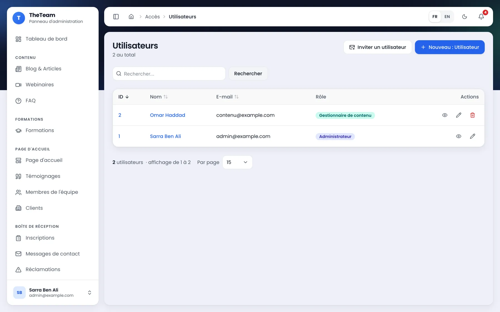
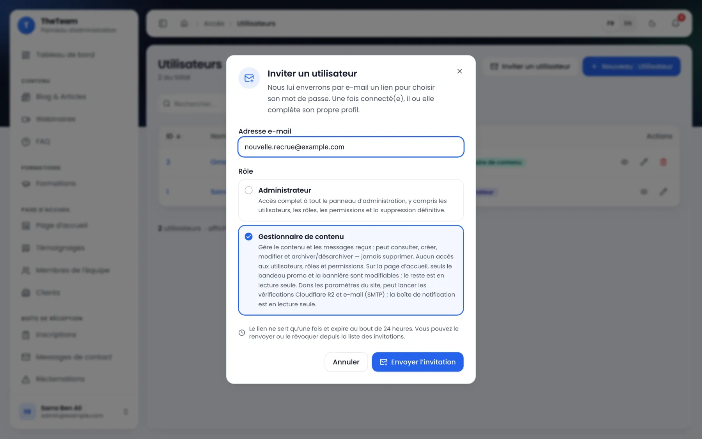
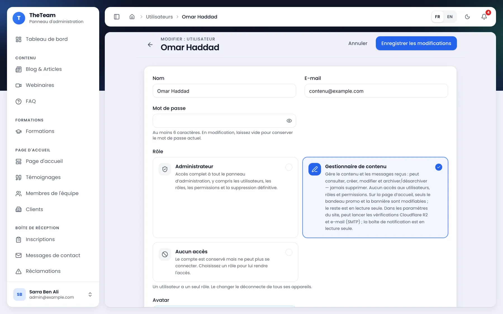
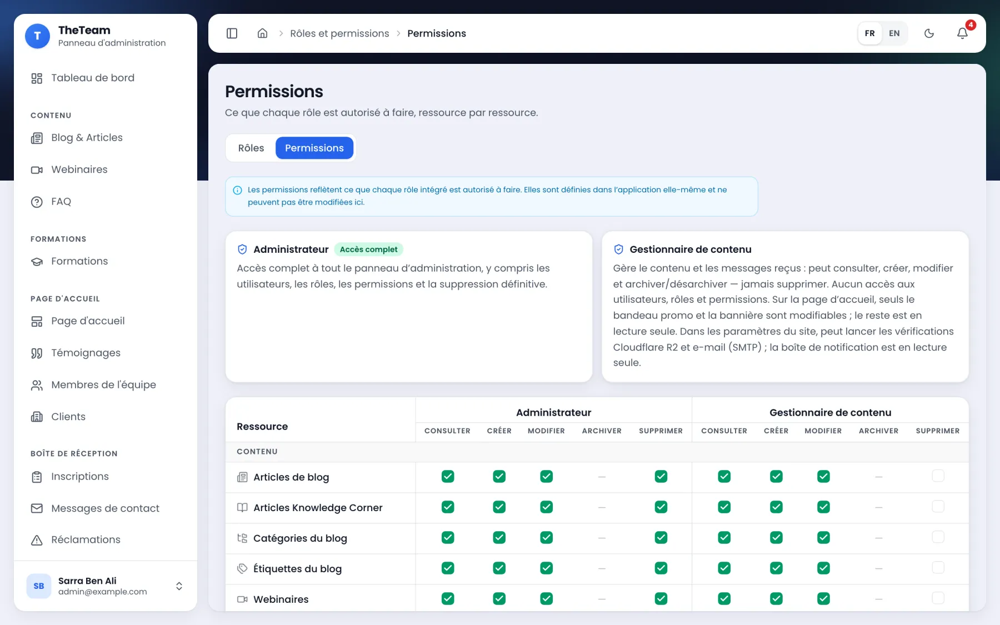

<Warning>
  **Réservé aux administrateurs.** Le gestionnaire de contenu ne voit pas cette partie du menu.
</Warning>

Menu **Accès → Utilisateurs**. On y gère les comptes de l’équipe qui utilisent le panneau. Il n’y a pas d’inscription libre : **chaque compte est créé par un administrateur**.

<Frame caption="La liste des utilisateurs avec le rôle de chacun.">
  
</Frame>

## Inviter un nouveau membre (recommandé)

L’invitation est la méthode la plus simple et la plus sûre : la personne choisit elle-même son mot de passe.

<Steps>
  <Step title="Cliquez sur « Inviter un utilisateur »">
    En haut à droite de la liste.
  </Step>
  <Step title="Saisissez son adresse e-mail">
    L’adresse professionnelle de la personne.
  </Step>
  <Step title="Choisissez son rôle">
    **Administrateur** ou **Gestionnaire de contenu**. En cas de doute, choisissez Gestionnaire de contenu : il sera toujours possible de changer plus tard.
  </Step>
  <Step title="Cliquez sur « Envoyer l’invitation »">
    La personne reçoit un e-mail avec un lien **valable 24 heures**, utilisable une seule fois.
  </Step>
</Steps>

<Frame caption="La fenêtre « Inviter un utilisateur ».">
  
</Frame>

Les invitations envoyées s’affichent au-dessus de la liste (onglets **En attente** / **Toutes**), avec leur date d’expiration. Pour chacune, vous pouvez :

- **Renvoyer** : envoie un nouveau lien (si le premier a expiré ou a été perdu) ;
- **Révoquer** : annule l’invitation, le lien ne marche plus.

<Note>
  Le bouton **Nouveau : Utilisateur** crée aussi un compte, mais c’est vous qui fixez le mot de passe et devez le transmettre à la personne. Préférez l’invitation.
</Note>

## Changer le rôle d’un utilisateur

Ouvrez l’utilisateur (crayon), cliquez sur la carte du rôle voulu, puis **Enregistrer les modifications**.

<Frame caption="La fiche d’un utilisateur : le rôle se choisit en cliquant sur une carte.">
  
</Frame>

- Un utilisateur a **un seul rôle** à la fois.
- **Changer son rôle le déconnecte de tous ses appareils** : il devra se reconnecter.
- **Aucun accès** garde le compte mais l’empêche de se connecter. C’est la bonne option quand quelqu’un quitte l’équipe : son nom reste sur ses articles et dans le journal d’activité. Choisissez un rôle pour lui rendre l’accès.
- Vous ne pouvez pas retirer votre propre rôle d’administrateur ni supprimer votre propre compte : le panneau garde toujours au moins un administrateur.

## Les rôles et les permissions

Menu **Accès → Rôles et permissions**. Ces pages sont **pour information** : elles montrent ce que chaque rôle a le droit de faire. Les rôles sont définis dans l’application et ne se modifient pas ici.

<Frame caption="L’onglet Permissions : une coche verte = autorisé ; une case vide = non autorisé.">
  
</Frame>

Le tableau croise chaque partie du panneau (lignes) avec les actions **Consulter, Créer, Modifier, Archiver, Supprimer** (colonnes), pour chaque rôle. Un tiret signifie que l’action n’existe pas pour cette partie. Le résumé en français se trouve aussi sur la page [Bienvenue](/guide-utilisateur#qui-peut-faire-quoi).
