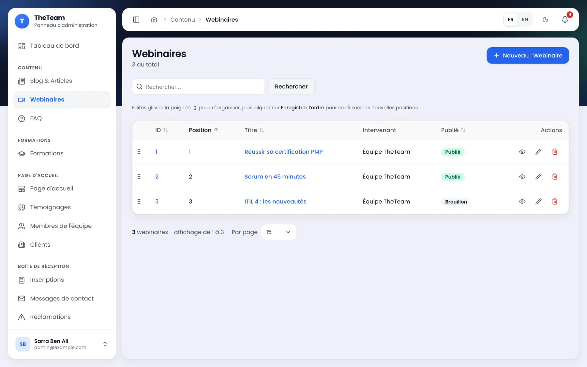
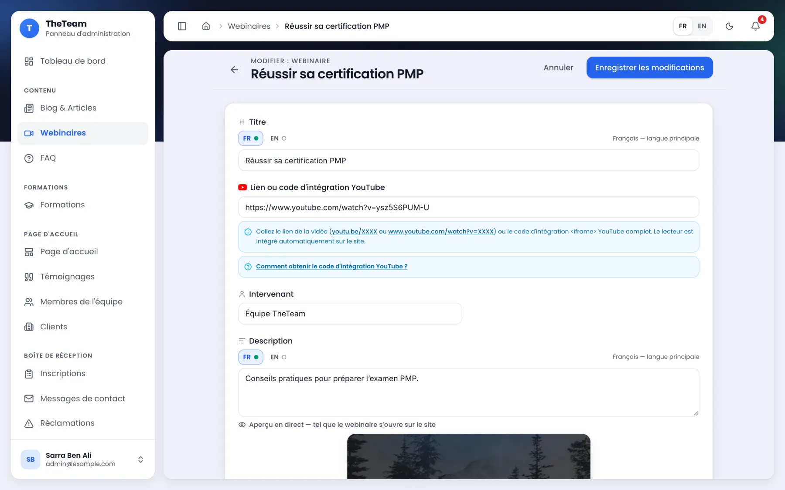
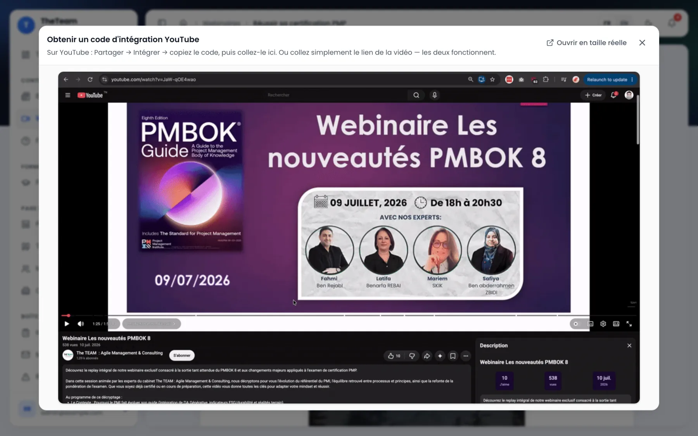

<Info>
  **Les deux rôles** peuvent créer et modifier les webinaires et la FAQ. Seul un **administrateur** peut supprimer.
</Info>

## Les webinaires

Menu **Contenu → Webinaires**. Chaque webinaire est une vidéo **YouTube** affichée sur le site.

<Frame caption="La liste des webinaires. « Brouillon » = pas encore visible sur le site.">
  
</Frame>

<Steps>
  <Step title="Cliquez sur « Nouveau : Webinaire »">
    Le bouton bleu en haut à droite.
  </Step>
  <Step title="Donnez un titre">
    En français (et en anglais si vous l’avez).
  </Step>
  <Step title="Collez le lien YouTube">
    Le lien de la vidéo (`youtu.be/…` ou `www.youtube.com/watch?v=…`) ou le code d’intégration fourni par YouTube : les deux fonctionnent.
  </Step>
  <Step title="Indiquez l’intervenant et une description">
    Puis vérifiez l’**aperçu en direct** en bas du formulaire : c’est exactement ce que verront les visiteurs.
  </Step>
  <Step title="Publiez">
    Activez **Publié** et enregistrez.
  </Step>
</Steps>

<Frame caption="La fiche d’un webinaire, avec l’aperçu en direct en bas.">
  
</Frame>

<Tip>
  Vous ne savez pas où trouver le lien ? Cliquez sur **Comment obtenir le code d’intégration YouTube ?** sous le champ : une petite animation montre le chemin (sur YouTube : **Partager → Intégrer → Copier**).
</Tip>

<Frame caption="L’aide intégrée au formulaire.">
  
</Frame>

## La FAQ

Menu **Contenu → FAQ** : les questions fréquentes affichées sur le site.

<Frame caption="La liste des questions. La poignée à gauche de chaque ligne permet de changer l’ordre.">
  
</Frame>

- **Ajouter une question** : **Nouveau : FAQ**, puis remplissez **Question** et **Réponse**, activez **Publié** et cliquez sur **Créer**.
- **Changer l’ordre** : faites glisser les lignes avec la poignée, puis cliquez sur **Enregistrer l’ordre**.
- **Masquer une question** sans la supprimer : désactivez **Publié**.

La fiche d’une question est montrée dans [Découvrir le panneau](/guide-utilisateur/interface#les-fiches-et-formulaires).
