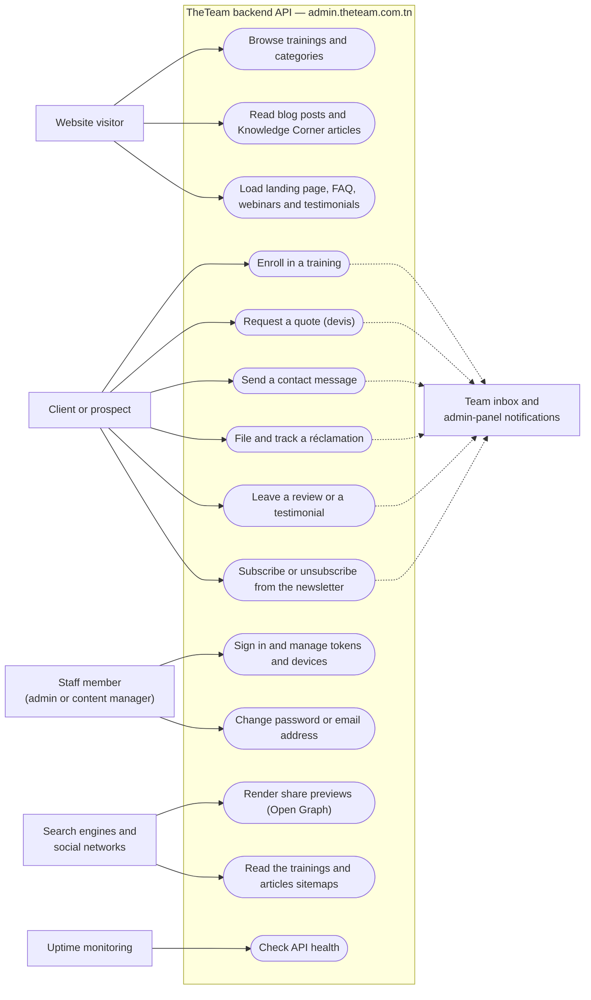
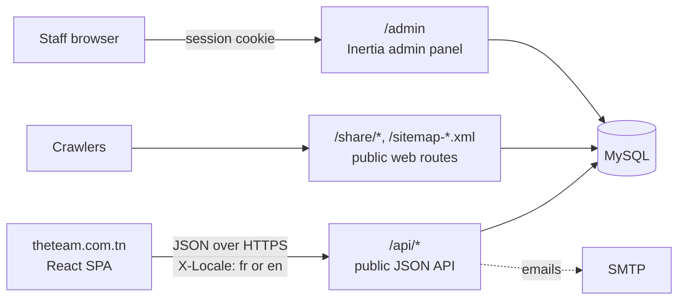

The **TheTeam API** is the JSON API of the TheTeam website backend, a Laravel 12 application served at
`https://admin.theteam.com.tn`. The public website [theteam.com.tn](https://theteam.com.tn), a static
React app, reads all of its dynamic content from this API and posts every public form to it.

<CardGroup cols={2}>
  <Card title="Content" icon="graduation-cap" href="/api-reference/trainings/overview">
    Trainings, blog posts, Knowledge Corner articles, landing page, FAQ, webinars.
  </Card>
  <Card title="Forms" icon="paper-plane" href="/api-reference/forms/overview">
    Contact, enrollment, devis, newsletter, réclamations, reviews and testimonials.
  </Card>
  <Card title="Authentication" icon="key" href="/api-reference/auth/overview">
    Staff tokens, devices, password and email-address changes.
  </Card>
  <Card title="System" icon="heart-pulse" href="/api-reference/system/overview">
    Health check, status page, share pages and sitemaps.
  </Card>
</CardGroup>

## At a glance

| | |
| :-- | :-- |
| **Base URL** | `https://admin.theteam.com.tn/api` |
| **Format** | JSON in and out. Send `Accept: application/json` on every request. |
| **Authentication** | None for content and public forms. Staff-account endpoints use a [Sanctum bearer token](/concepts/authentication). |
| **Language** | French by default, English with `X-Locale: en` or `?lang=en`. See [Localization](/concepts/localization). |
| **Rate limits** | Per IP, on the form and token endpoints only. See [Rate limits](/concepts/rate-limits). |
| **CORS** | Every origin is allowed. |

## Your first request

Content endpoints need no key:

```bash
curl "https://admin.theteam.com.tn/api/trainings?per_page=5" \
  -H "Accept: application/json" \
  -H "X-Locale: en"
```

The answer is a `{ data, pagination }` envelope; open one item with its slug, for example
`GET /api/trainings/formation-pmi-acp`. Without `Accept: application/json`, errors come back as HTML or
redirects instead of JSON. See [Responses and errors](/concepts/responses-and-errors).

<Warning>
  Form endpoints (`POST /contact-us`, `/enrollments`, `/devis`…) write to the **production** database,
  notify the staff and send real emails. Their pages show a copyable request instead of a live
  playground: test them against a [local backend](#run-the-backend-locally).
</Warning>

## Use cases

The diagram shows who uses the backend and for what. Each use case maps to one or more endpoints in the
Content, Forms, Authentication and System tabs.



Dotted arrows are side effects. Every accepted form submission stores a notification for each staff
account (the admin panel's bell; for the newsletter, only when the address is new). Contact, devis,
review and réclamation submissions also email the team inbox, and réclamation confirmations go to the
client with the team in CC.

## How the pieces fit



- **Public JSON API (`/api/*`).** Documented here. Read endpoints serve only published content.
  Form endpoints validate, store and notify.
- **Public web routes.** Open Graph share pages and XML sitemaps for crawlers, plus a health check, in
  the [System](/api-reference/system/overview) tab.
- **Admin panel (`/admin`).** Staff manage every resource there, over session authentication with
  HTML and Inertia responses. **It is not a JSON API** and is not covered by these docs.

## Run the backend locally

Use a local backend to try the form and account endpoints without touching production:

```bash
cd official_website_backend
composer install && npm install
php artisan key:generate
php artisan migrate --seed
php artisan serve --port=8020
```

Then call `http://127.0.0.1:8020/api` instead of the production base URL. Set `MAIL_MAILER=log` in your
local `.env` so form submissions write emails to the log instead of sending them.

<Note>
  The backend needs a PHP release patched against php2shell (8.2.35+, 8.3.36+, 8.4.27+ or 8.5.12+).
  XAMPP's PHP 8.2.4 is refused by Composer; use Homebrew `php@8.2` or newer.
</Note>
