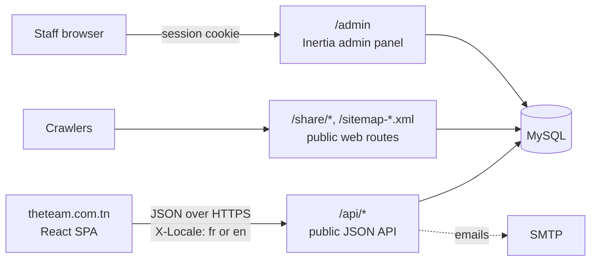

The **TheTeam API** is the JSON API of the TheTeam website backend, a Laravel 12 application served at
`https://admin.theteam.com.tn`. The public website [theteam.com.tn](https://theteam.com.tn), a static
React app, reads all of its dynamic content from this API and posts every public form to it.

<CardGroup cols={2}>
  <Card title="Quickstart" icon="rocket" href="/quickstart">
    Make your first request and fetch the training catalogue in French or English.
  </Card>
  <Card title="API reference" icon="code" href="/api-reference/overview">
    All 50 endpoints, each with request and response examples.
  </Card>
</CardGroup>

## At a glance

| | |
| :-- | :-- |
| **Base URL** | `https://admin.theteam.com.tn/api` |
| **Format** | JSON in and out. Send `Accept: application/json` on every request. |
| **Authentication** | None for content and public forms. Staff-account endpoints use a [Sanctum bearer token](/concepts/authentication). |
| **Language** | French by default, English with `X-Locale: en` or `?lang=en`. See [Localization](/concepts/localization). |
| **Rate limits** | Per IP, on the form and token endpoints only. See [Rate limits](/concepts/rate-limits). |
| **CORS** | Every origin is allowed. |

## Use cases

The diagram shows who uses the backend and for what. Each use case maps to one or more endpoints in the
[API reference](/api-reference/overview).

Dotted arrows are side effects. Every accepted form submission stores a notification for each staff
account (the admin panel's bell; for the newsletter, only when the address is new). Contact, devis,
review and réclamation submissions also email the team inbox, and réclamation confirmations go to the
client with the team in CC.

## How the pieces fit

- **Public JSON API (`/api/*`).** Documented here. Read endpoints serve only published content.
  Form endpoints validate, store and notify.
- **Public web routes.** Open Graph share pages and XML sitemaps for crawlers, plus a health check.
  They are in the API reference under [Share pages & sitemaps](/api-reference/web/share-blog).
- **Admin panel (`/admin`).** Staff manage every resource there, over session authentication with
  HTML and Inertia responses. **It is not a JSON API** and is not covered by these docs.

## Endpoint groups

<CardGroup cols={3}>
  <Card title="Authentication" icon="key" href="/api-reference/auth/login">
    Staff tokens, devices, password and email changes.
  </Card>
  <Card title="Trainings" icon="graduation-cap" href="/api-reference/trainings/list">
    Catalogue, training details, picker options, categories.
  </Card>
  <Card title="Blog" icon="newspaper" href="/api-reference/blog/list-posts">
    Posts, pinned posts and categories.
  </Card>
  <Card title="Knowledge Corner" icon="book-open" href="/api-reference/articles/list">
    Long-form articles, facets and related articles.
  </Card>
  <Card title="Site content" icon="house" href="/api-reference/content/landing-page">
    Landing page, testimonials, webinars, FAQ, pages, menu.
  </Card>
  <Card title="Forms & submissions" icon="paper-plane" href="/api-reference/forms/contact-us">
    Contact, enrollment, devis, newsletter, réclamation, reviews.
  </Card>
</CardGroup>
