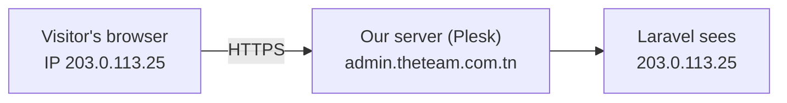
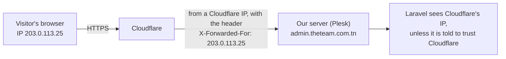

This page is for whoever manages the hosting (Plesk) or the domain's DNS (Cloudflare). For the
plain-language background (why the limits need each visitor's own IP, and the 2-minute check), read
[Client IP and rate limits](/security/client-ip-and-rate-limits) first.

## In one minute

- The rate limits recognise visitors by their **IP address**.
- Today, visitors' browsers talk **directly** to our server, so Laravel sees each visitor's own IP.
  Nothing needs configuring.
- If a **proxy** such as Cloudflare is put in front of `admin.theteam.com.tn`, our server only sees
  **Cloudflare's** IP. Every visitor then shares one counter, and a few visitors can get everyone
  blocked.
- The fix is to tell Laravel to **trust Cloudflare, and only Cloudflare**. Trusting everyone instead
  would let attackers fake their IP and never hit a limit.
- The steps are below. Do them **before** switching Cloudflare's proxy on.

## How a request reaches the backend

**Today, without a proxy:**



**With Cloudflare's proxy switched on:**



Cloudflare writes the visitor's real IP into a header called `X-Forwarded-For`. Laravel only reads
that header when the request comes from an address it has been told to trust.

## What uses the visitor's IP

| Where | What happens if Laravel sees Cloudflare's IP instead |
| :-- | :-- |
| Rate limits (the 300/min safety net and every per-endpoint limit) | All visitors share one counter. A few failed logins block the login for everyone; a busy minute blocks the whole site. |
| Admin panel → **Security** → Connected devices, and [List devices](/api-reference/auth/list-devices) | Every device shows a Cloudflare address. |
| Security emails ("your password was changed", "email change requested") | They show a Cloudflare address instead of the requester's. |

Limits counted **per account** (changing a password or an email address) are not affected.

## Which hostname matters

In Cloudflare's DNS page, every record has a cloud icon:

- **Grey cloud, "DNS only":** Cloudflare only tells browsers where the server is. Traffic still goes
  directly to our server. **Nothing changes.**
- **Orange cloud, "Proxied":** all traffic goes through Cloudflare. **Cloudflare is now a proxy.**

| Hostname | If it is proxied (orange cloud) |
| :-- | :-- |
| `admin.theteam.com.tn` (the API and the admin panel) | **Matters.** Follow the setup below before switching it on. |
| `theteam.com.tn` (the public site) | **No effect on the limits.** The site's pages call `admin.theteam.com.tn` directly from the visitor's browser. |

## Set up Cloudflare for admin.theteam.com.tn

<Steps>
  <Step title="Check the starting point">
    Do the [2-minute check](/security/client-ip-and-rate-limits#check-it-yourself-2-minutes) now, while
    traffic still goes straight to the server. You should see two different IP addresses.
  </Step>
  <Step title="Tell Laravel to trust Cloudflare (developer)">
    In the backend's `bootstrap/app.php`, inside `withMiddleware(...)`, add:

    ```php
    // At the top of the file:
    use Illuminate\Http\Request;

    // Inside withMiddleware(function (Middleware $middleware) { ... }):
    $middleware->trustProxies(
        at: [
            // Every range listed on https://www.cloudflare.com/ips/
            // (IPv4 and IPv6), copied as they are, for example '192.0.2.0/24'.
        ],
        headers: Request::HEADER_X_FORWARDED_FOR | Request::HEADER_X_FORWARDED_PROTO,
    );
    ```

    Also update the comment above `$middleware->throttleApi()`, which explains why the setting is
    absent today.

    - `X-Forwarded-For` carries the visitor's IP; `X-Forwarded-Proto` tells Laravel the visitor used
      HTTPS.
    - The other forwarded headers (such as `X-Forwarded-Host`) are left out on purpose, so a request
      cannot change the host name Laravel uses to build links.

    Deploy it (with `php artisan optimize:clear`, then the usual caches). It is safe to deploy
    **before** Cloudflare is switched on: requests that come straight to the server do not come from a
    Cloudflare address, so Laravel keeps ignoring their `X-Forwarded-For` header.
  </Step>
  <Step title="Set Cloudflare's SSL/TLS mode to Full (strict)">
    Cloudflare → `theteam.com.tn` → **SSL/TLS** → **Full (strict)**. Our server already serves HTTPS
    with a valid certificate, so Cloudflare can talk to it encrypted.

    Do **not** use **Flexible**. That mode sends traffic between Cloudflare and our server **unencrypted**
    (passwords and tokens included), and it can cause endless redirects.
  </Step>
  <Step title="Keep Cloudflare from getting in the way of the API">
    - **No "Cache Everything" rule** on `admin.theteam.com.tn`. Cloudflare could serve one visitor's
      answer, or an admin page, to someone else. Cloudflare's default caching (static files only) is
      fine.
    - **No challenge pages on `/api`** ("I'm Under Attack" mode, or rules that show a challenge). The
      public site calls the API from JavaScript, which cannot solve a challenge, so pages would come up
      empty.
  </Step>
  <Step title="Switch the proxy on">
    In Cloudflare's DNS page, set the `admin` record to the **orange cloud** (Proxied).
  </Step>
  <Step title="Check that it works">
    1. Traffic goes through Cloudflare:

       ```bash
       curl -sI https://admin.theteam.com.tn/api/health | grep -i -E "^(server|cf-ray):"
       ```

       You should see `server: cloudflare` and a `cf-ray` line.
    2. Laravel still sees each visitor's own IP: repeat the
       [2-minute check](/security/client-ip-and-rate-limits#check-it-yourself-2-minutes). The two
       devices must show **two different addresses**, and neither may be a Cloudflare address. If
       they still show one shared address, switch the record back to the grey cloud and ask a
       developer to look into it before trying again.
  </Step>
</Steps>

## Why trust only Cloudflare's addresses

Anyone can write an `X-Forwarded-For` header. What Laravel does with it depends on whom it trusts:

| Request | Trusting **Cloudflare's ranges** | Trusting **everyone** (`at: '*'`) |
| :-- | :-- | :-- |
| A normal visitor, through Cloudflare | Their real IP | Their real IP |
| A visitor who adds a fake `X-Forwarded-For` before going through Cloudflare | Their real IP (Cloudflare adds the real IP at the end, and Laravel reads from the end) | Their real IP |
| An attacker who finds the server's address and sends requests **straight to it** with a fake `X-Forwarded-For` | **Their real IP**: the header is ignored | **The fake IP**: a new one on every request, so the attacker is never limited |

So **never use `at: '*'`** here, even though some tutorials suggest it.

## Keep it working

- **Cloudflare's list of addresses changes rarely, but it can.** If the list in `bootstrap/app.php`
  is out of date, visitors arriving through a new Cloudflare address share one counter again. Compare
  the list with [cloudflare.com/ips](https://www.cloudflare.com/ips/) from time to time, and whenever
  the Security page shows Cloudflare addresses.
- **Switching Cloudflare off later** (back to the grey cloud) needs no change in Laravel. Requests no
  longer come from Cloudflare addresses, so the setting simply has no effect. Do the 2-minute check
  afterwards.
- **Moving the backend to another host**, or adding any other proxy, CDN or load balancer: do the
  2-minute check, and ask a developer to trust that proxy's addresses if it is needed.

## Hide the PHP version

By default, every response from the backend's PHP carries a header like this:

```http
x-powered-by: PHP/8.4.27
```

It tells anyone, including automated scanners, the **exact PHP version** the server runs. When a PHP
flaw such as [php2shell](/security/php2shell) is published, attackers scan the internet for servers
announcing a vulnerable version. Hiding the header fixes nothing by itself (only updating PHP does),
but it stops the server from advertising its version, which matters most on the day it falls behind.

Cloudflare does **not** remove this header, so this step is needed with or without Cloudflare.

<Steps>
  <Step title="Confirm PHP is patched first">
    The header is also the quickest way to see which PHP version the website really runs. Check it
    once before hiding it:

    ```bash
    curl -sI https://admin.theteam.com.tn/api/health | grep -i "x-powered-by"
    ```

    The `PHP/…` value must be **8.4.27 or later** (or 8.5.12 or later). If not, follow
    [php2shell](/security/php2shell) first.
  </Step>
  <Step title="Switch it off in Plesk">
    Plesk → **Websites & Domains** → `admin.theteam.com.tn` → **PHP Settings**. At the bottom, in
    **Additional configuration directives**, add this line, then click **OK** (or **Apply**):

    ```ini
    expose_php = off
    ```
  </Step>
  <Step title="Check it">
    ```bash
    curl -sI https://admin.theteam.com.tn/api/health | grep -i "x-powered-by"
    ```

    Only `x-powered-by: PleskLin` should remain, with no `PHP/` line.

    If the `PHP/` line is still there, set `expose_php = Off` in the configuration of the PHP version
    the domain uses (on Plesk, under `/opt/plesk/php/8.4/etc/`), then restart that PHP service, or ask
    the hosting provider to do it.
  </Step>
</Steps>

What stays visible after this, and why it is fine:

- `x-powered-by: PleskLin`: added by Plesk itself. It says "Plesk on Linux", with no version number.
- `server: nginx`: the web server's name, with no version number.

<Note>
  The backend's deployment guide (`DEPLOY_PLESK.md`) uses `x-powered-by: PHP` in a response as a hint
  that Laravel answered rather than nginx. Once the version is hidden, that hint is gone.
</Note>

Related: [Client IP and rate limits](/security/client-ip-and-rate-limits) ·
[Rate limits](/concepts/rate-limits) · [php2shell](/security/php2shell)
