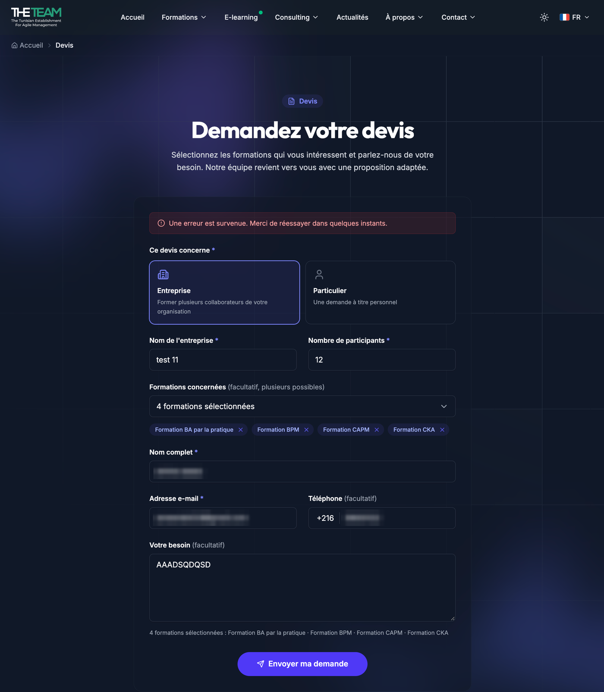

<Warning>
  **Status: open, raised on 2026-11-15.** The fix is one block in the server's nginx settings
  ([The fix](#the-fix-plesk-about-2-minutes)). Once it is applied and [verified](#verify), change this
  line to "Fixed on `YYYY-MM-DD`" and remove the known-issue warning from the
  [Forms overview](/api-reference/forms/overview).
</Warning>

## What happens

<Frame caption="theteam.com.tn/devis on 2026-11-15, after pressing “Envoyer ma demande”. Personal details are blurred.">
  
</Frame>

- Submitting the form shows **"Une erreur est survenue. Merci de réessayer dans quelques instants."**
- In Chrome DevTools → **Network**, the `devis` request is marked **CORS error**, and a separate
  `OPTIONS` request to the same URL (type *preflight*) answered **405**. The console reports that the
  request "has been blocked by CORS policy: Response to preflight request doesn't pass access control
  check: It does not have HTTP ok status".
- The request never reaches the backend: no row in the database, no email, no admin notification.

### Affected forms

Every form that posts JSON from the site to the API:

| Form on theteam.com.tn | Endpoint |
| :-- | :-- |
| Devis | [`POST /devis`](/api-reference/forms/create-devis) |
| Contact | [`POST /contact-us`](/api-reference/forms/contact-us) |
| Inscription à une formation | [`POST /enrollments`](/api-reference/forms/create-enrollment) |
| Newsletter (footer and `/newsletter` page) | [`POST /newsletter`](/api-reference/forms/newsletter-subscribe), [`POST /newsletter/unsubscribe`](/api-reference/forms/newsletter-unsubscribe) |
| Réclamation | [`POST /reclamation-submissions`](/api-reference/forms/create-reclamation) |
| Avis | [`POST /review-submissions/create`](/api-reference/forms/create-review) |
| Témoignage | [`POST /testimonials`](/api-reference/forms/submit-testimonial) |

Pages that only **read** content (trainings, blog, articles, landing page) keep working, and so do
calls made outside a browser (cURL, a server): only browsers send the preflight.

## Why it happens

1. **The site and the API are two origins** (`theteam.com.tn` and `admin.theteam.com.tn`). Before a
   cross-origin `POST` with `Content-Type: application/json`, the browser first sends an `OPTIONS`
   request, the **preflight**, asking the API whether the site may post. Only a `2xx` answer that
   carries `Access-Control-Allow-Origin` lets the real `POST` go out.
2. **The site's read requests skip that step.** They send only `Accept` and pass the language as
   `?lang=`, which makes them "simple" requests with no preflight. That is why content pages work and
   forms don't.
3. **nginx stops the preflight.** For performance, `admin.theteam.com.tn` runs with Plesk's
   **Proxy mode off** (the backend's `DEPLOY_PLESK.md`): nginx serves the domain itself and Apache, whose
   `.htaccess` used to send every request to `index.php`, no longer runs. For a pretty URL such as
   `/api/devis`, nginx hands `GET`, `HEAD` and `POST` to PHP but answers every other method itself with
   its static **405** page — `OPTIONS` included. Laravel never sees the preflight.

### Proof (2026-11-15)

| Request sent to `https://admin.theteam.com.tn` | Answer | Who answered |
| :-- | :-- | :-- |
| `OPTIONS /api/devis` — the preflight the browser sends | `405`, static HTML error page | nginx |
| `OPTIONS /index.php` — the same preflight, sent to the front controller directly | `204` with `Access-Control-Allow-Origin: https://theteam.com.tn` | Laravel |
| `POST /api/devis` with an empty body | `422` with the French validation errors and the CORS headers | Laravel |
| `GET /api/health` | `200` | Laravel |

The backend answers the preflight correctly. nginx just doesn't forward it on pretty `/api/` URLs.

## Is it the Laravel 12 upgrade? Can CORS stay in the backend?

- **Not the upgrade.** CORS has been built into Laravel since 9.2:
  `Illuminate\Http\Middleware\HandleCors`, configured by `config/cors.php` and built on
  `fruitcake/php-cors` (the library behind the old `fruitcake/laravel-cors` package, which the backend
  never needed). Laravel 11 ran the same middleware. The 405 is produced by **nginx, before PHP runs**,
  so no Laravel version, package or setting can cause or cure it. The cause is the switch to nginx-only
  serving (Proxy mode off, documented in `DEPLOY_PLESK.md` from 2026-09-07). The admin panel hit the
  same wall with `PUT`/`DELETE` (`DEPLOY_PLESK.md` §5c), which was worked around by sending them as
  `POST`.
- **CORS stays in the backend.** The fix below adds no CORS header in nginx. It only lets the `OPTIONS`
  request reach Laravel, which already answers it from `config/cors.php`. The nginx block **is**
  necessary though: without it, the preflight never gets to Laravel.

## The fix (Plesk, about 2 minutes)

1. Plesk → **Websites & Domains** → `admin.theteam.com.tn` → **Apache & nginx Settings**.
2. In **Additional nginx directives**, **keep** the existing `/storage/` block and add the `/api/`
   block below it. The whole box then reads:

   ```nginx
   # Existing: serve uploads through the public/storage symlink.
   location ~ ^/storage/ {
       disable_symlinks off;
   }

   # Send every /api/ request, including the browser's OPTIONS preflight, to
   # Laravel's front controller. Laravel (config/cors.php) answers the preflight.
   location ^~ /api/ {
       try_files $uri /index.php?$query_string;
   }
   ```
3. Press **OK**. Plesk tests the configuration before applying it; if it is refused, nothing changed.

Why it looks like this:

- **The two blocks are independent.** The new one doesn't replace the `/storage/` one: they match
  different paths (`/storage/…` and `/api/…`), so both stay.
- **Only `/api/`.** Every public form posts there. A catch-all `location /` can clash with the
  `location /` that Plesk may generate for the domain (nginx refuses duplicate locations), and the admin
  panel doesn't need it (it sends only `GET`/`POST`).
- **`^~`** tells nginx to use this block for `/api/` URLs without trying the regex locations. The
  internal redirect to `/index.php` is then handled by Plesk's usual PHP location, and Laravel still
  sees the original URL (`/api/devis`).
- **Putting Cloudflare in front later changes nothing here**: Cloudflare forwards `OPTIONS` requests
  (see [Cloudflare and proxies](/security/cloudflare-and-proxies)).

## Verify

From any terminal:

```bash
curl -s -o /dev/null -D - -X OPTIONS https://admin.theteam.com.tn/api/devis \
  -H 'Origin: https://theteam.com.tn' \
  -H 'Access-Control-Request-Method: POST' \
  -H 'Access-Control-Request-Headers: content-type' \
  | grep -iE '^HTTP|access-control-allow'
```

- **Fixed:** `HTTP/2 204` followed by `access-control-allow-origin: https://theteam.com.tn` and the other
  `access-control-allow-*` lines.
- **Not fixed yet:** `HTTP/2 405` and no `access-control-allow` line.

Then in the browser: send the devis form once with test data. DevTools → Network shows the `OPTIONS`
preflight answered `204`, then `POST /api/devis` answered `201`, and the success window opens. Archive
and delete the test request in the admin panel (**Inbox → Devis**).

## Roll back

Remove the `/api/` block from **Additional nginx directives** and press **OK**. The site goes back to the
state described at the top of this page.

## After the fix

- Change the status at the top of this page to "Fixed on `YYYY-MM-DD`".
- Remove the known-issue warning from the [Forms overview](/api-reference/forms/overview).
